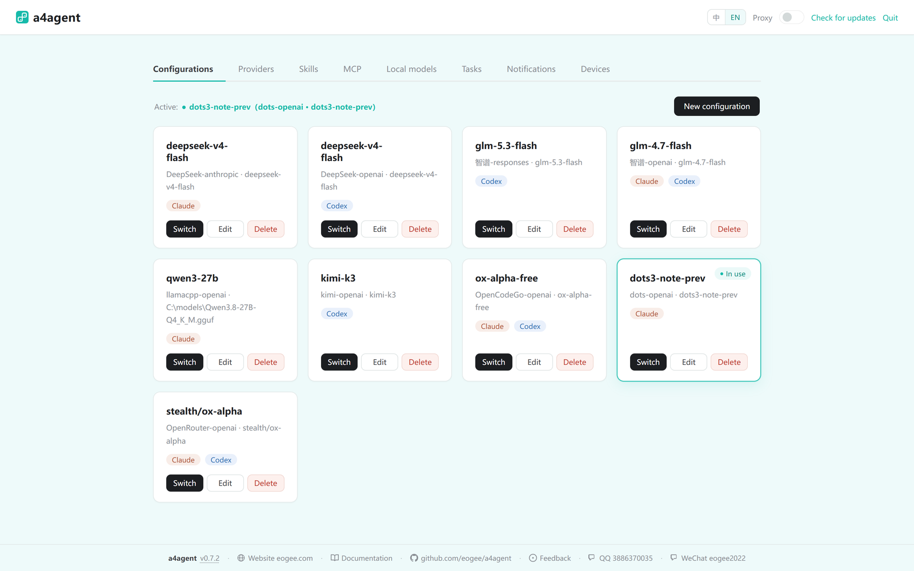
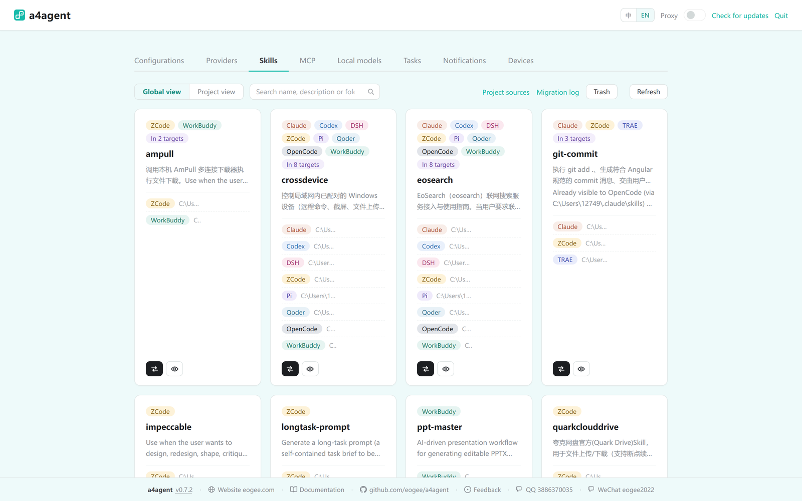
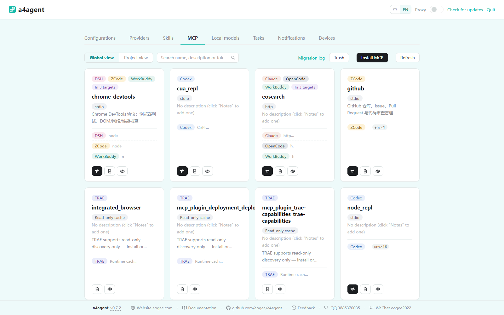
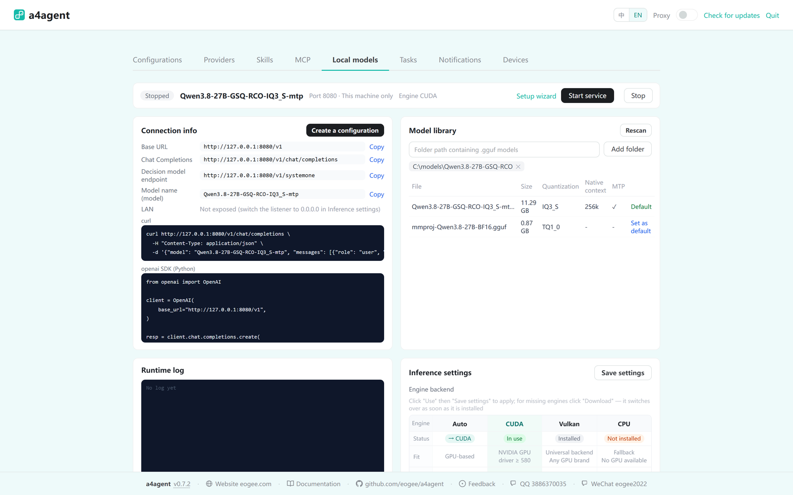
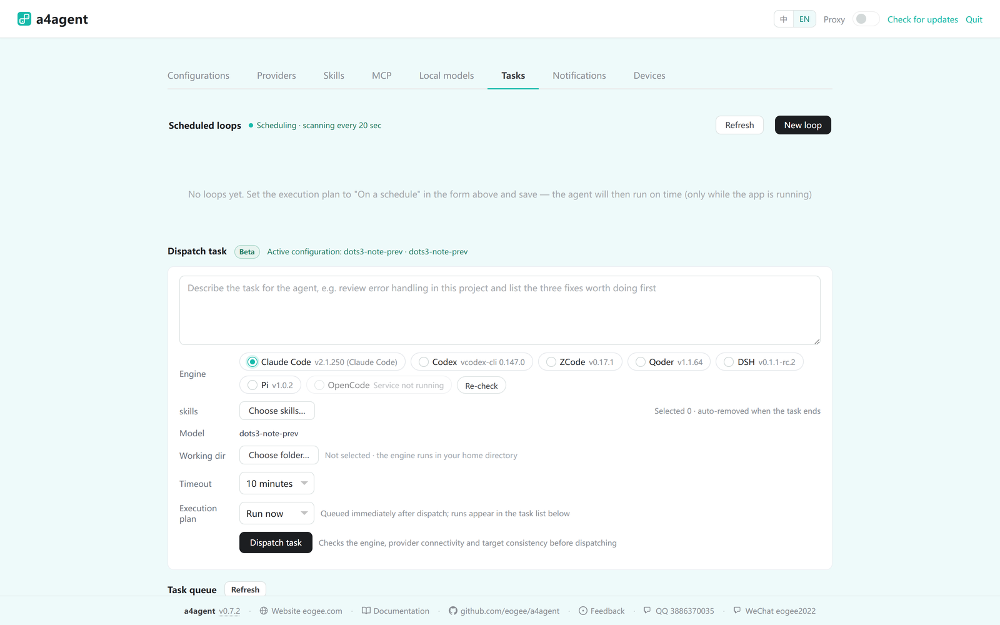
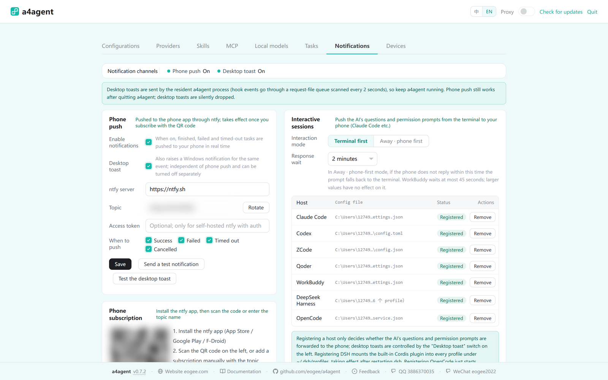
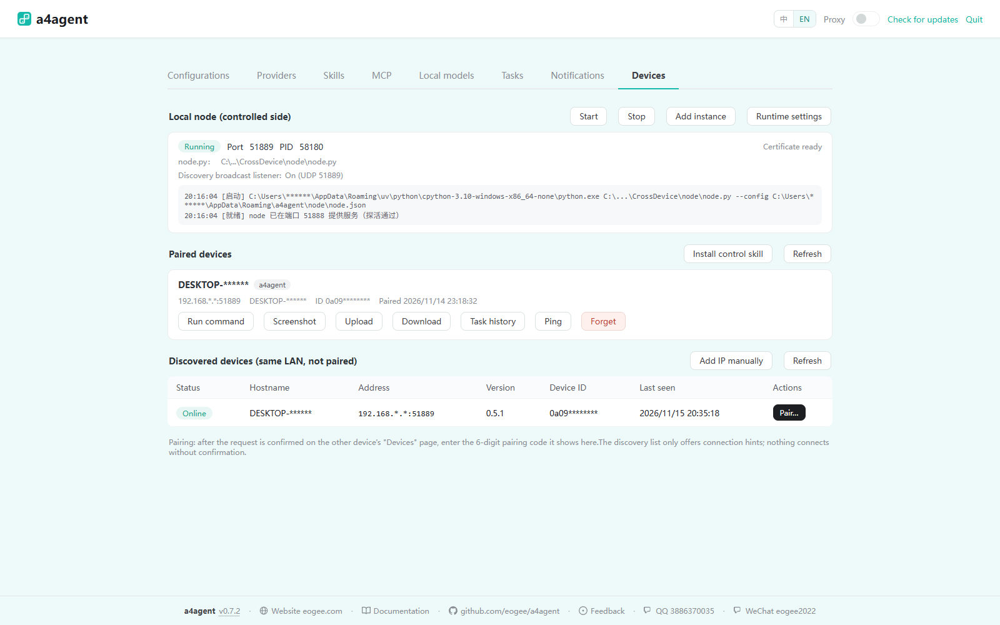

# a4agent

English | [简体中文](README.zh-CN.md)

[](https://hub.xerj.org/contributors/eogee)

**A management console for nine AI coding tools + a local LLM inference console**: unified **skill management** and **MCP management** across all nine tools — **Claude Code, Codex, dsh (DeepSeek Harness), ZCode (Zhipu Agentic Dev Environment), pi (local pi coding agent), Qoder (AI IDE), OpenCode, WorkBuddy, and TRAE** — plus API provider switching for the two CLI tools without a graphical config UI (Claude Code, Codex), a built-in llama.cpp local model inference console, headless task dispatch for seven tools (with recurring tasks and per-task skill injection), phone push & desktop toasts, and CrossDevice remote device control. Everything is done through a visual interface; no manual config-file editing required.

| Capability | Description |
|---|---|
| **Skill Management** | Auto-discovery of global/project-level skills on all nine tools, aggregation badges, cross-tool migration, recycle-bin restore, one-click sync of a project's skills to every missing tool |
| **MCP Management** | Auto-discovery and **one-click install** of MCP servers on all nine tools, cross-tool migration (validated by a transport capability matrix), snapshot recycle bin, automatic/custom **descriptions**; secrets are masked/encrypted throughout |
| **API Switching** | One-click provider / model / API-key switching for the two CLI tools without a graphical UI (Claude Code, Codex), with automatic backup, atomic writes, and DPAPI-encrypted key storage; the other seven tools have their own provider UIs and are configured by the user in-app |
| **Local Models** | Turn any `.gguf` model into an OpenAI-compatible local/LAN API service in one click: engine auto-download by GPU, model library scanning, VRAM risk assessment, one-click profile creation for Claude Code / Codex |
| **Task Dispatch** | Run any of the seven tools in **headless mode** as background tasks: dispatch-and-return, three pre-flight checks (engine ready / config ready / real connectivity), queue polling, output archiving, cancel & timeout, and tasks survive closing the window; recurring tasks (once / interval / daily / weekly) and per-task skill injection are supported. Uses the config you already set up in each app |
| **Notifications** | Two independent channels — phone push (ntfy) and desktop toasts — in **one unified format** (topic name / notification type / app name, plain text without emoji); session hooks for **Claude Code / Codex / ZCode / Qoder / WorkBuddy / dsh** (OpenCode joins through its service event listener) let you answer the agent's questions and approve permissions from your phone |
| **Device Networking** | CrossDevice (MIT) as the controlled-device runtime: LAN discovery, one-confirmation pairing, remote commands / screenshots / file transfer / task history — and the device capability can be installed as a skill for the AI agents in your workspaces |
| **Interface language** | Switch the UI between Chinese and English from the `中 / EN` control in the top-right corner; the choice is persisted locally and defaults to your system language on first launch |

---

## Quick Start

### Download & Install

Download the installer `a4agent-setup-*.exe` from the **Releases** page:

- **Download**: https://github.com/eogee/a4agent/releases (choose the latest version)
- **Requirements**: Windows 10/11 64-bit
- Verify the SHA256 checksum shown on the release page to make sure the file is intact

The installer is **per-user (no UAC)**: double-click and follow the wizard into your user directory — no administrator rights needed at any point; Start-menu and desktop shortcuts are created automatically, and the app can be uninstalled from "Settings → Apps". If **Windows SmartScreen** appears on first run, click "More info → Run anyway" (the app has no commercial code signing — normal, doesn't affect functionality).

### Running & the Interface

After installation, start a4agent from the **Start menu** or the **desktop shortcut**. The main UI has eight tabs: **Profiles** (API switching, Claude Code & Codex only), **Providers**, **Skills**, **MCP**, **Local Models** (llama.cpp inference console), **Task Dispatch** (headless agent tasks), **Notifications** (phone push + desktop toasts), and **Devices** (cross-device control). Switch the UI language from the `中 / EN` control in the top-right corner.

### Data & Privacy

- Runtime data (database, config backups) goes to `%APPDATA%\a4agent\`; logs go to `~/.a4agent/logs/`
- Headless task output goes to `%APPDATA%\a4agent\task_outputs\` (same level as config backups, accessible only to the local user); output is raw engine output and may contain code, paths, and other sensitive content — "Feedback" does **not** attach task output automatically, and deleting a task deletes its output file too
- API keys are stored encrypted with Windows DPAPI, bound to the current Windows user
- Original config files are backed up before any modification (`~/.claude/settings.json` / `~/.codex/config.toml`, rolling, last 5 kept)

### FAQ

- **Antivirus flags the app**: PyInstaller-packed programs are occasionally false-flagged; add a trust/exclusion, or submit the sample to the vendor to appeal
- **Upgrading**: just run the new `a4agent-setup-*.exe` over the old install — data and config (`%APPDATA%\a4agent\`) are preserved; the background translation proxy is stopped and old files cleaned before upgrading
- **Upgrading from a4api (v0.3.x → v0.4.0+)**: the product was renamed to a4agent — install the new version directly. First launch migrates `%APPDATA%\a4api\` data into `%APPDATA%\a4agent\` automatically, the installer moves the program directory and cleans old shortcuts, and the `a4api_p*` managed entries previously written to Claude Code / Codex are replaced with `a4a_p*` on the next switch — nothing to do by hand
- **Uninstall**: uninstall from "Settings → Apps"; program files are removed while runtime data (database, config backups) stays in `%APPDATA%\a4agent\` — delete that directory manually for a thorough cleanup
- **Task dispatch**: closing the main window is **not exiting** — a4agent moves to the background and finishes the tasks; starting the app again brings back the original window. To truly exit use the top-bar "Exit"
- **Feedback**: the in-app entry is recommended — see "Feedback" near the end of this document

### Auto-Update

After a new version is released to GitHub/Gitee, the app checks silently **at startup** or when you click "Check for updates" in the top bar. After you confirm, it downloads the installer with a progress bar; once the download passes verification, one more confirmation runs the installer to finish the upgrade. You can also "skip this version".

Update sources & verification:

- **Dual-source racing download**: the installer downloads from the GitHub and Gitee mirrors **at the same time, fastest wins** (both mirrors are bound to the same SHA256); a lead of more than 8MB declares victory and the progress bar always shows the leader. GitHub assets are often ~0.1 MB/s from China; racing lands you on Gitee's ~2 MB/s automatically
- **Signed update manifest**: the release side signs `latest.json` (version, release notes, installer SHA256, etc.) with an Ed25519 private key, and the app verifies it with the built-in public key; any field anomaly or signature mismatch and the manifest is discarded — **no update prompt**. URLs are not part of the signature; what a URL serves is pinned by the signed SHA256
- **Integrity check**: the installer's SHA256 is computed while downloading and must match the signed manifest before it lands on disk (`%APPDATA%\a4agent\updates\<version>\`); clicking "Update now" **re-verifies** the on-disk file before launching the installer
- **Transport whitelist**: HTTPS only, and every redirect hop is checked against a host whitelist (`github.com` / `gitee.com` / the two `*.githubusercontent.com` object-storage domains / `*.gitee.com`)
- **No downgrades**: a candidate version must be strictly higher than the running one; versions below the manifest's `min_version` are refused; pre-release versions are only offered when the running version is also a pre-release
- **Size caps**: manifest 512KB, installer 300MB; downloads write only to the user data directory, never the system temp directory

Update flow: a dialog shows the version number and release notes → confirm to download in the background (cancellable) → once verified, click "Update now": the app first stops the local translation proxy, exits automatically releasing the single-instance lock, then launches the Inno Setup wizard — config, database, and keys are fully preserved.

---

## API Provider Switching (Profiles · Providers)

a4agent provides one-click switching for **CLI tools without a graphical config UI**: currently **Claude Code** and **Codex**. The "Providers" page maintains providers (protocol, endpoint, API key); the "Profiles" page combines them with models into switchable profiles — one click to switch, with the active profile always visible in the top bar.

Profiles page: one-click "Switch / Edit / Delete" on profile cards, the active profile visible in both the top bar and the card:



- **Claude Code**: direct Anthropic protocol, or through the built-in **local translation proxy** that translates requests in real time to OpenAI Chat Completions for OpenAI-compatible providers (the proxy listens on `127.0.0.1` only, authenticates with a random token, and survives after the app exits)
- **Codex**: OpenAI Responses protocol written to `~/.codex/config.toml`; connects directly when the upstream natively supports Responses (e.g. DeepSeek), otherwise forwards through the local translation proxy
- Before switching, the target config file is backed up automatically (rolling, last 5 kept) and written atomically; API keys are stored encrypted with Windows DPAPI and never echoed back by the API

### Why Only These Two Are Managed

The criterion is a single one: **does the target app ship a complete provider configuration UI?**

| Tool | What the app itself can do | a4agent's approach |
|---|---|---|
| Claude Code | None, pure CLI | Managed (the only viable path) |
| Codex CLI | None, pure CLI | Managed (the only viable path) |
| dsh | Settings → Models: three API protocols + fetch model list | Configure in-app |
| ZCode | Settings → Model providers: dual endpoint URLs + per-model capabilities | Configure in-app |
| pi | Switch directly via `/model` | Configure in-app |
| Qoder | 9 preset providers + custom endpoints + connectivity check | Configure in-app |

For those apps, managing their config files externally is neither easier (a few clicks in-app is faster) nor safer: capability toggles, context windows, and enablement states visible in the UI are unknowable from outside, so an external writer can only fill conservative defaults. The criterion is "**the user can configure it themselves**", not "we can't read its config" — Qoder's model catalog may be encrypted so we can't write plaintext, but users configure it just fine in its own UI. A technical obstacle is not a product rationale.

See the [migration reference table](docs/迁移对照表-三端API配置.md) (in Chinese) for field mappings and UI entry points per tool. Task dispatch covers all seven tools and **directly uses the config you already set up in each app** — a4agent no longer writes API configs for these apps; it only runs a real-connectivity pre-flight check before dispatching (see "Task Dispatch").

---

## Skill Management

All nine targets use the same skill format (a `<skill-name>/SKILL.md` directory with `name` and `description` frontmatter), so a4agent can manage them as one kind of resource.

Skills page: skills from all nine tools aggregated into cards, tool badges showing presence and paths; "Project sources / Migration log / Recycle bin" live in the top-right corner, with a global/project view toggle:



### Discovery & Aggregation

- Scans the **global** and **project-level** skill directories of all nine tools, and aggregates by frontmatter `name`: when a skill with the same name exists on several tools, it is badged as "already on N tools".
- **Project discovery works two ways.** Scan ranges default to every drive on the machine (each first-level folder counts as a project), *and* a4agent reads the history the AI tools already keep — Claude Code's project list, Codex session working directories, and the recent workspaces of VS Code-family editors — so projects nested at any depth show up without you pointing at them. Only projects containing at least one skill are listed.
- The **Project sources** dialog lists what was auto-discovered (with the tool it came from), lets you ignore entries, add scan ranges with a folder picker, or restore the default ranges.
- Codex's reserved global directories (`.system/` and other dot-prefixed dirs) are skipped automatically and not treated as user skills.

### Cross-Tool Migration & "One-Click Sync to Every Tool"

- Any skill on any tool can be migrated to any target (global or any project). Migration is a **non-destructive copy**: the source is always kept.
- Migration targets support **picking any project folder**: the target project needs no prior skills, and a missing `.{tool}/skills` directory is created automatically; both the desktop app and the browser build use the same built-in folder picker.
- If the target already has a skill with the same name (matching frontmatter `name` or directory name), the old version goes to the recycle bin instead of being silently overwritten.
- **"One-click sync to every tool"**: fills in every missing tool for all skills in a project at once — first shows a plan list, then runs with a progress bar while the page is temporarily locked to prevent accidental edits.
- Every migration writes a **migration log** (time, skill, source, target, result) for full traceability.

### Recycle Bin

- Deleted skills go to the recycle bin and can be restored in place or permanently deleted within **30 days**; restoring into an occupied location fails with a clear error — never overwrites.
- Expired entries are lazily cleaned the next time you open the recycle bin, and the result reports how many were purged.

### Skill Directories per Tool

| Tool | Global (user-level) | Project-level |
|---|---|---|
| Claude Code | `~/.claude/skills/` | `<project>/.claude/skills/` |
| Codex | `~/.codex/skills/` | `<project>/.codex/skills/` |
| dsh | `~/.dsh/skills/` (overridable via `$DSH_HOME`) | `<project>/.dsh/skills/` |
| ZCode | `~/.zcode/skills/` | `<project>/.zcode/skills/` |
| pi | `~/.pi/agent/skills/` (overridable via `$PI_CODING_AGENT_DIR`) | `<project>/.pi/skills/` |
| Qoder | `~/.qoder/skills/` (overridable via `$A4AGENT_QODER_HOME`) | `<project>/.qoder/skills/` |
| OpenCode | `~/.config/opencode/skills/` | `<project>/.opencode/skills/` |
| WorkBuddy | `~/.workbuddy/skills/` (overridable via `$A4AGENT_WORKBUDDY_SKILLS_PATH`) | `<project>/.workbuddy/skills/` |
| TRAE | `~/.trae-cn/skills/` (overridable via `$A4AGENT_TRAE_HOME` / `$A4AGENT_TRAE_SKILLS_PATH`) | `<project>/.trae/skills/` |

**TRAE**: the user skill directory TRAE actually scans is `skills` under its product-data folder (`~/.trae-cn/skills` on this machine), in the same format as the other tools, so no special handling is needed. `~/.trae-cn/builtin/global/skills` is the materialized directory for TRAE's **built-in** skills and is rewritten wholesale by TRAE updates, so a4agent never writes to or manages it. TRAE has no hook protocol and no headless CLI, so this covers skill management plus read-only MCP discovery only.

**ZCode**: the official client also recognizes the cross-tool directories `~/.agents/skills` and `<project>/.agents/skills`; a4agent standardizes on the `.zcode` prefix for consistency with the other tools. Skills migrated to ZCode are really loaded by the ZCode client.

**pi**: global skills live under the **agent subdirectory** (`~/.pi/agent/skills`, not `~/.pi/skills`). pi validates skills more strictly than the other tools: `name` must be lowercase letters, digits, and hyphens (≤64 chars, no leading/trailing hyphen or consecutive hyphens), and `description` is required (≤1024 chars). Non-conforming skills are **simply not loaded by pi**. When migrating to pi, a4agent re-checks against pi's rules and warns clearly in the migration result instead of leaving a "migrated successfully but nowhere to be found" state.

**Qoder**: besides `~/.qoder/skills`, it also recognizes the cross-tool directories `~/.agents/skills` and `<project>/.agents/skills` (lower priority); a4agent standardizes on the `.qoder/skills` prefix, so no project-level special-casing is needed. The config directory name varies by distribution (international `.qoder`, China `.qoder-cn`); a4agent detects whichever actually exists, or you can set `A4AGENT_QODER_HOME` directly.

**OpenCode**: the global root is `~/.config/opencode/skills` (not `~/.opencode/skills`); project-level skills live in `.opencode/skills`. Two behaviors are handled specially, because getting them wrong would be visible: **skill IDs come from the directory name** (the frontmatter `name` is only a display label), so aggregation and conflict resolution go by directory name — otherwise two skills with the same display name but different IDs would be merged into one card, or one of them deleted during migration; and **it auto-discovers `~/.claude/skills` and `~/.agents/skills`** (`.agents` is additionally ZCode's / Qoder's cross-tool directory), so those entries are badged "already visible to OpenCode" and the one-click sync skips them — no pointless duplicate copy.

---

## MCP Management

Except for TRAE (MCP config lives in an encrypted internal database and is read-only discoverable), each of the nine tools stores its MCP servers in its own config file; a4agent normalizes them into one view (`name` / `transport` / `command` / `args` / `env` / `url` / `headers`).

MCP page: servers across all nine tools aggregated into one card view — transport, description and host tool at a glance; "Install MCP" creates from scratch or bulk-imports pasted JSON:



### Discovery & Aggregation

- Auto-discovers global and project-level MCP servers on all nine tools and aggregates same-name servers across tools ("already on N tools").
- **TRAE is read-only**: TRAE keeps user-level MCP config in an encrypted internal database (`ModularData/ai-agent/database.db`, not standard SQLite); the only plaintext side is the runtime cache `~/.trae-cn/mcps/<workspace>/<agent>/<server>/` (`SERVER_METADATA.json` + `tools/*.json`). a4agent reads **server names and tool lists** from that cache, labels the card "TRAE supports read-only discovery only", never fabricates connection settings, and offers no install/delete/migrate actions — do those inside TRAE. Override the cache location with `$A4AGENT_TRAE_MCP_CACHE_PATH`.
- `env` / `headers` are always **masked** in detail views (key names only); the API never returns plaintext secrets.
- Every server card shows a **description**: common servers are recognized automatically (a built-in digest library plus live npm registry lookups for npx packages, both cached with failure fallbacks), and you can also click "Describe" to write your own (stored locally, shared across tools, cleared when left empty).
- Project-level files are recognized automatically: Claude Code `.mcp.json`, Codex `.codex/config.toml`, ZCode `.zcode/config.json`, pi `.pi/mcp.json` (Qoder's project level *is* Claude Code's `.mcp.json`, managed under the Claude tool and not discovered twice). WorkBuddy is global-only — it has no workspace-level MCP file.

### Installing MCP Servers

- Click "Install MCP" to create a server from scratch on any app: pick a target app (Claude Code / Codex / dsh / ZCode / pi / Qoder / OpenCode / WorkBuddy — written to that app's global config) and a transport (stdio / http / sse, filtered by the target's capabilities — e.g. Codex is stdio-only, pi and OpenCode have no sse), then fill in command/args/env or URL/headers. TRAE keeps MCP config in an encrypted internal database, so it never appears as an install or migration target.
- You can also **paste JSON to import in bulk**: paste an existing MCP config snippet (three formats supported: a top-level "mcpServers" object, a name-keyed server dictionary, or a single server object) and install many at once — each entry is independent, so one failure (name conflict, unsupported transport, etc.) doesn't abort the rest, and each reports success/failure.
- Installation uses each tool's native rendering and atomic writes (a same-name server on the target is explicitly rejected — use migration or delete first); existing servers and unrelated config keys are preserved. Installed servers appear in the card list immediately with descriptions auto-matched.

### Cross-Tool Migration & the Transport Capability Matrix

- Any server on any tool can be migrated to any target; if the target has a same-name server, it is **snapshotted to the recycle bin first**, and the target config file is backed up before writing.
- Migration is strictly validated against the **transport capability matrix**; incompatible pairs fail as a whole and are logged — **no silent degradation**:

| Target | Transports supported | Config file |
|---|---|---|
| Claude Code | stdio / sse / http | `~/.claude.json` (global), `<project>/.mcp.json` (project) |
| Codex | stdio | `~/.codex/config.toml` (`[mcp_servers.*]`) |
| dsh | stdio / streamable-http | `~/.dsh/profiles/<profile>/cordis.patch.yml` |
| ZCode | stdio / sse / http | `~/.zcode/cli/config.json`, `<project>/.zcode/config.json` (`mcp.servers`) |
| pi | stdio / streamable-http | `~/.pi/agent/mcp.json` (global), `<project>/.pi/mcp.json` (project; the project must be trusted by pi) |
| Qoder | stdio / sse / http | `~/.qoder/mcp.json` (global; project level reuses Claude Code's `<project>/.mcp.json`) |
| OpenCode | stdio / streamable-http | `~/.config/opencode/opencode.json(c)`, `<project>/.opencode/opencode.json(c)` (`mcp.servers`) |
| WorkBuddy | stdio / sse / http (written as `streamableHttp`) | `~/.workbuddy/mcp.json` (global only) |
| TRAE | Write not supported (read-only discovery) | Encrypted internal database; plaintext side is only the `~/.trae-cn/mcps` runtime cache |

Tool-specific notes (a4agent preserves each tool's own keys losslessly on read and write):

- **dsh**: MCP servers hang off the `@deepseek-ai/dsh-mcp-client` plugin entry; rewrites preserve other non-managed entries. No project-level MCP.
- **ZCode**: the config schema is strict (unknown keys are dropped), so a4agent writes only its canonical fields (`type`/`command`/`args`/`cwd`/`env`/`url`/`headers`/`enabled`/`timeoutMs`); servers migrated to ZCode are connected automatically by the client.
- **pi**: structurally identical to Claude Code (top-level `mcpServers`), but it **explicitly rejects legacy SSE** (`type: "sse"` is invalid) — migrating an sse entry to pi fails as a whole and is logged. Server names accept only letters, digits, `_`, and `-`; names containing Chinese characters or dots are rejected explicitly at migration/install time (they would be dead entries once written). The project-level file does not accept the `auth` key — it is stripped automatically on write and logged.
- **Qoder**: structurally identical to Claude Code; its own keys `disabled` (the in-Qoder switch for turning a server off — note it is **not** `enabled`), `timeout`, and `authType` are preserved losslessly. **Project-level MCP shares the same `<project>/.mcp.json` as Claude Code** (it looks up `.mcp.json` first, then `mcp.json`), so a4agent does not let the Qoder tool take over project-level files — the same file written by two tools would just stomp each other; migrating to Claude project level makes it effective for Qoder project level too. The runtime mirrors (`%APPDATA%\Qoder\SharedClientCache\extension\local\mcp.json`, `~/.qoder/mcp-router.json`) are in-process state; a4agent neither reads nor writes them and excludes them from backups.
- **OpenCode**: servers live under `mcp.servers` with exactly two transports — `local` (stdio) and `remote` (Streamable HTTP). There is **no place for legacy SSE**, so sse sources fail as a whole and are logged. Three shape differences are smoothed over by a4agent: the command is a **single array** (executable and arguments merged; split only when writing back), the environment key is `environment` (not `env`), and the on/off switch is `disabled`. Its own keys `codemode` / `timeout` / `protocol` / `oauth` are preserved losslessly.
- **WorkBuddy**: structurally identical to Claude Code, but the http transport literal is camelCase **`streamableHttp`** (neither `http` nor `streamable-http` — an entry written as `http` is simply not recognized, so a4agent normalizes to `http` internally and writes the camelCase form back); `timeout` is a **per-entry** key, and unrecognized keys are read into `extra` and written back losslessly. Only the global file is managed: WorkBuddy has **no workspace-level MCP config file**, so install and migration targeting project level fail explicitly instead of writing a file nothing reads (skills are different — `<workspace>/.workbuddy/skills` exists, so project-level skill discovery and migration work as usual).

**OpenCode's config file is JSONC** (comments and trailing commas allowed): a4agent writes standard JSON (which is valid JSONC) and reads existing files with comments correctly, but **hand-written comments in that file are lost on write** — an inherent trade-off of whole-subtree replacement. If comments matter to you, configure it in OpenCode's own UI instead. If reading the config fails, a4agent aborts the write rather than rebuilding from an empty config (which would wipe your model / agents / permissions).

**It is normal for the Qoder view to "show no connected MCP"**: a4agent manages the **user-defined** `~/.qoder/mcp.json`; most connectors actually connected in a Qoder session do not come from that file — built-in connectors (browser control, node REPL, etc.) ship with the installer, and plugin-bundled connectors live in `~/.qoder/plugins/cache/<source>/<plugin>/mcp.json`. To make a server show up in the Qoder view, write it into this file via "Install MCP" or cross-tool migration.

### Recycle Bin & Data Protection

- Replaced/deleted server config snippets are **snapshotted to the recycle bin** (restorable within 30 days); `env` / `headers` inside snapshots are **DPAPI-encrypted** at rest and decrypted on restore.
- Every migration writes a log; discovery, preview, and recycle-bin APIs mask sensitive fields throughout.

---

## Local Models (llama.cpp Inference Console)

Local Models page: three cards — connection info, model library and inference settings — with live service status and engine logs; you're notified when the health check turns ready:



The "Local Models" tab wraps llama.cpp's `llama-server` into a one-click **OpenAI-compatible API service**: which engine to install, which model to serve, and with what parameters — all through the UI.

**Engine version**: llama.cpp **b11719** (nightly, 2026-10-18, pinned in `backend/app/llama/catalog.py` as the single source of truth). This version's `llama-server` includes the decision-model endpoint, which enables the capability below.

### Decision Model (System One)

Besides the usual `/v1/chat/completions` and `/v1/models`, this engine build also exposes a **`/v1/systemone` decision-model endpoint** — the "Connect" card shows its full URL with ready-to-copy curl / OpenAI SDK examples. You can hand scheduling decisions like "which model to use, how to decompose a task" to the local engine while the main model stays in the cloud, forming a cloud-edge split.

### First-Run Setup Wizard

Five steps: "Get engine → Detect hardware → Pick model directories → Pick default model → Server port":

- **Hardware detection & preset recommendation**: enumerates GPUs via `nvidia-smi` and the registry (vendor, VRAM, driver version); recommends inference presets by VRAM tier (context length, KV cache quantization, MTP speculative decoding) and warns about VRAM overflow when picking a model
- **Engine auto-download**: downloads official prebuilt llama.cpp **engines** matched to your GPU (pinned versions, reproducible), four options:

  | Engine | For | Size | Min driver |
  |---|---|---|---|
  | CUDA 13.4 | NVIDIA (performance-first) | 552 MB | 580 |
  | CUDA 12.4 | NVIDIA (older drivers) | 628 MB | 550 |
  | Vulkan | NVIDIA / AMD / Intel discrete & integrated | 31 MB | none |
  | CPU | Fallback when no usable GPU | 18 MB | none |

  **Offline install** (point to a directory containing `llama-server.exe`) or skip-for-now are also supported; a CUDA engine = main package + cudart runtime package, auto-merged after download
- **One engine per backend, switchable in Settings**: engines install into `%LOCALAPPDATA%\Programs\a4agent-<backend>\engine`, so re-downloading one backend never overwrites an engine another backend is using. The backend actually running is detected from the DLLs present (`ggml-cuda` > `ggml-vulkan` > `ggml-cpu`) and shown in the title bar; the Local Models settings show an **Engine backend** comparison table (Auto / CUDA / Vulkan / CPU side by side with status, fit and action per column) — installed engines get a "Use" button, missing ones a download entry, and switching takes effect on the next service start
- If an older a4agent installation exists, its engine directory is **adopted** automatically — no re-download

### Model Library & Running the Service

- Add multiple model directories; `.gguf` files are scanned and their metadata parsed: **size, quantization, native context, whether MTP layers exist** (speculative decoding capable); one click to "set as default model"
- "Start service" shows live status (starting / running / failed / stopped) and engine logs; you're notified when the health check turns ready; port conflicts, missing engines, and process crashes all produce clear log messages; scheduled memory trimming is supported
- Inference parameters are adjustable in the UI: context length, KV cache level (f16/q8_0/q4_0), Flash Attention, GPU layers, API-key auth, and an extra-args escape hatch
- **MTP speculative decoding steps are auto-detected**: llama.cpp's MTP (Multi-Token Prediction) syntax changed across versions — older builds used `--mtp N`, from b105xx it is `--spec-type draft-mtp --spec-draft-n-max N`. a4agent runs `llama-server --help` once to **auto-detect** which syntax the current backend supports before passing parameters, so engine upgrades never break startup

### LAN Access & One-Click Connect

- The "Connect" card shows the Base URL, Chat Completions URL, decision endpoint (System One), model name (the `model` field), and copy-ready **curl / OpenAI SDK** examples; once listening is switched to `0.0.0.0` in inference settings, the actual LAN address is shown
- **"Create connect profile"** builds a configuration profile pointing at the local service in one click; tick which apps to write (Claude Code / Codex) in the dialog, switch on the "Profiles" page, and the app runs on your local model — seamlessly interchangeable with cloud APIs

---

## Task Dispatch (Headless Agent Tasks)

Task Dispatch page: the dispatch form (task / engine / skills / timeout) and the task queue on one screen; uninstalled engines are greyed out with the reason, and recurring tasks are managed on the same page:



The "Task Dispatch" tab productizes each tool's **headless mode**: write a one-line task description, pick an engine, and a4agent launches the CLI in the background, waits for it to finish, and archives the output while you do other things.

### Supported Engines

| Engine | Headless command | Output format |
|---|---|---|
| **Claude Code** | `claude -p "<task>" --output-format json` | Single JSON object; output in `result`, includes token usage and cost |
| **Codex** | `codex exec --json --ephemeral` | JSONL event stream; output taken from `agent_message` events |
| **ZCode** | `zcode -p "<task>" --json` | Single JSON object; output in `text`, plus `toolCalls` / `usage` / `stopReason` |
| **Qoder** | `qodercli -p "<task>" -o json` | Single JSON object |
| **dsh** | `dsh --profile headless "<task>"` | Raw stdout (body field extracted when parseable as JSON) |
| **pi** | `pi -p "<task>" --mode json --no-session` | JSONL event stream; success decided by `stopReason`, text taken from events |
| **OpenCode** | **No CLI** — a session against the running service | Session message stream; cost/usage/outcome come from the session's terminal state |

- Engines are auto-detected (installed? version? executable path); **uninstalled engines are greyed out** in the UI with the reason
- Every command name is resolved to an absolute path first: on Windows these CLIs are npm `.cmd` shims, and handing the bare name to `subprocess` fails to start. Qoder's command is `qodercli` in official docs but `qoder` in blog posts — both are probed
- Nobody can click "approve" in headless mode, so every command carries permission pre-authorization flags, otherwise the run sticks at an approval prompt or is rejected outright: Claude Code `--permission-mode bypassPermissions`, Codex `--sandbox danger-full-access`, ZCode `--mode yolo`, Qoder and pi `--yolo` (dsh needs none — its headless profile is the headless entry point). dsh additionally gets a `--patch` overlay that disables the external plugins in its profile (the headless profile lacks the host services they depend on, and startup fails without it), leaving the profile itself untouched

### OpenCode: How It Differs

The other six spawn a fresh CLI process per task. OpenCode is **driven through the service you already have running** (default `127.0.0.1:49374`; the service password and port are discovered automatically; a remote address works too). That buys three things a CLI cannot offer:

- **Approval-free execution without touching global config**: pre-authorization is a **session-scoped permission rule** (verified: the session object echoes it back), discarded when the task ends. Other tools can only rely on global switches like `--yolo` / `bypassPermissions`.
- **Success is reported, not guessed**: the session reports `outcome` (succeeded / failed / interrupted) together with cost and usage, and failures carry a structured `error` instead of requiring you to reverse-engineer an exit code.
- **Interrupt instead of kill**: cancelling sends an interrupt to the server-side session.

OpenCode therefore also skips the "you must have an active profile first" requirement — its models and credentials live in OpenCode, not in a4agent's profile system. One subtle failure mode we found by testing: a model the service still reports as `enabled=true` may already be deprecated upstream and only fail on a real run. Both the pre-flight check and the real dispatch retry with another available model when they hit that.

### Automatic Pre-Flight Checks (no dispatch unless everything passes)

Clicking "Dispatch task" runs three synchronous checks; any failure means the engine is **not started**, with a plain-language reason:

| Step | What is checked |
|---|---|
| Engine available | The target CLI is installed and really executable (result cached 5 minutes) |
| Config ready | Reads **your own in-app config** to see whether a provider and model are set. When unreadable (e.g. Qoder's encrypted model catalog), it says honestly "cannot verify — judge by the real run" instead of pretending to pass |
| Real connectivity | Actually runs one minimal headless call; only real output counts as pass |

A real call gives an honest answer no matter how you configured it: bad key, misspelled model name, network down — one call exposes it all. If the config isn't ready, the live test is skipped (it would fail for sure, wasting your time). A blocked task still leaves a `precheck_failed` record, visible in the queue with which step failed and how long it took.

### Recurring Tasks (Execution Plans)

The "Task Dispatch" page also hosts **recurring tasks**: define a headless task as a repeatable execution plan, and the scheduler fires it on time.

- **Four schedule types** (all in local time): `once` (one-shot, YYYY-MM-DD HH:MM), `interval` (every N minutes, capped at one week — longer should be daily/weekly), `daily` (fixed time every day), `weekly` (chosen weekdays + time)
- **Scheduling lives with the app**: the scheduler is a daemon thread inside the app process (20-second scan precision) and stops when the app exits. Triggers missed while the app was closed are recorded as `missed` by default; only with catch-up (catch_up) enabled is one catch-up run made
- **Each run lands as one task record** reusing the entire one-shot task chain: timeout, logs, cancellation and terminal-state notifications all take the same path; recurring tasks cap at 4 hours (manual tasks 1 hour)
- Page capabilities: create / edit, enable / disable, run now, run history & logs, delete

### Per-Task Skill Injection

None of the seven CLI tools has a "use this skill" command-line argument — skills are found by directory scanning (`~/.<tool>/skills` and `<workdir>/.<tool>/skills`). The dispatch form's **skill picker** injects the selected skills into the discovery path of the task's working directory so the agent actually uses them, and cleans them up when the task ends:

- **Add-only**: other skills already in the global/project roots load as usual; injection only adds
- **Yield on conflict**: if the target location already has a same-name directory, it is skipped — never overwritten, never recycled
- **Only touch its own entries**: cleanup removes only what this task injected; startup also sweeps crash leftovers
- **Per-tool compatibility warning**: skills the selected tool won't load (e.g. failing pi's naming rules) are flagged "this tool won't load this skill" right in the picker
- Recurring tasks support skills too — each trigger carries them into that run

### Queue & Output

- **Dispatch-and-return**: the API only creates the task row and hands it to a background thread pool (concurrency 5 by default, tunable via `A4AGENT_TASK_CONCURRENCY`); it does not wait for results
- State machine: `queued → running → completed / failed / timeout / canceled / precheck failed`; the UI polls every 2 seconds and the poller stops itself when everything is idle
- The "view output" dialog shows the engine's full output (long outputs return only the tail — the file always holds everything) and per-step pre-check timings
- Supports **cancel** (kills the whole process tree — node shims spawn children), task history, and delete (output file removed with it)
- Timeout defaults to 10 minutes (5–60 selectable); on expiry the process tree is killed and the task marked timeout
- Output lands in `%APPDATA%\a4agent\task_outputs\<task id>.jsonl|md`, alongside other runtime data

### Closing the Window Doesn't Kill Tasks

- **Closing the main window = moving to the background**: tasks and recurring tasks keep running; starting a4agent again reactivates the original instance's window instead of spawning a new process
- A **tray icon** stays resident: left-click brings the window back, the context menu exits directly. Shutdown collects the tray first, then the local inference engine and headless task child processes, so no orphans are left behind
- If a second launch cannot take the single-instance lock, it no longer stops at a bare "already running" box: it first tries to wake the hidden window, then falls back to a clean restart, and only then tells you what to do in Task Manager
- The real exit is the "**Exit**" button in the top bar, which tells you how many tasks are running and asks twice; on exit, running tasks are honestly marked "app exited" and their process trees terminated
- When a task reaches a final state: an in-page notice if the window is open; otherwise a **native system toast** (with sound; the source badge shows the a4agent logo and name; clicking it wakes the window) plus a flashing taskbar icon

---

## Notifications (Phone Push & Desktop Toasts)

Notifications page: phone push configuration (topic / QR code / subscribe URL) and the session-interaction host table on one page, with the desktop-toast toggle below (credential fields are blurred in the screenshot):



Two independent channels keep you off the desk, in **one unified format** across every channel — topic name / notification type / app name in three lines, plain text without emoji:

- **Phone push** (ntfy): task and session outcomes (success / failure / timeout) always carrying the **agent's last output**
- **Desktop toasts** (source badge: logo + a4agent): cover completions, failures, permission requests and questions, and wake the window on click
- **Session interaction**: session hooks for **Claude Code / Codex / ZCode / Qoder / WorkBuddy / dsh** push the agent's questions and permission requests to your phone for remote answering and approval (Approve / Always / Deny); in "away · phone-first" mode an unanswered prompt falls back to the terminal automatically
- **OpenCode, same treatment**: it has no hook protocol, so "Register" turns on a4agent's service event listener instead — sessions you start in OpenCode's web UI reach you through the same desktop toast (fired even when the window is open) and phone push when they finish, fail, or get interrupted; permission requests are pushed to your phone for remote approval and fed back through OpenCode's permission API so the session continues. Registering **writes nothing into its files**

---

## Device Networking (CrossDevice Remote Control)

Devices page: paired devices and LAN-discovered devices in separate sections, with remote command, screenshot, file and task-history entries on each card and the node runtime status always visible:



- The "Devices" page manages [CrossDevice](https://github.com/eogee/CrossDevice) (MIT) as the controlled-device runtime: a4agent launches and supervises the local node as an independent subprocess (auto-restart on exit, a circuit breaker after 5 consecutive fast crashes, automatic certificate generation when missing), and supports **named multi-instance** — every instance in the settings list is launched and guarded independently
- With a4agent installed on both machines, devices in the same LAN appear automatically under "Discovered Devices" via UDP broadcast (roughly a 10-second heartbeat, 30 seconds without frames marks a device offline); the broadcast only makes devices visible and **never grants trust by itself**
- **One-confirmation pairing**: click "Pair" on the controller → the controlled side's a4agent pops a confirmation window (showing the source IP) → once confirmed, a one-time 6-digit pairing code is displayed on screen (5-minute validity) → enter the code on the controller → the connection is established; remote commands, screenshots, file transfer and task history then work without manual setup. **A system toast announces incoming pairing requests** on the controlled side, so the Devices page doesn't need to be open to catch the moment
- If the controlled side clicks "Reject", no connection is made; exceeding the guess limit (5 by default) voids the pairing session; every success, failure and rejection is recorded in the controlled side's audit log
- Credentials of paired devices (tokens and certificate fingerprints) are stored locally encrypted with Windows DPAPI and are never returned in plain text through the API or files; a certificate fingerprint change is rejected, and the fingerprint can be reset from the Devices page to reconnect
- The node runtime files (node.py / gen_cert.ps1 / an embedded python interpreter) ship with the a4agent installer into the install directory `node_runtime/` — zero dependencies on a fresh machine; you can also point the Devices page at a custom path (in development, the CrossDevice repo works directly)

### Devices page: upload whitelist and staging folder

- **Write-direction operations** (upload / write / delete / mkdir / move) on paired devices are constrained by the controlled device's **workspace whitelist** (reads are unrestricted): with an empty whitelist by default, only the **node default staging folder** is writable (`tmp` under the controlled node's data directory, e.g. `%APPDATA%\a4agent\node\tmp`); everything else is rejected with 403 `SANDBOX_DENIED`. Explicitly configured roots and the staging folder coexist (up to 16 user roots; the staging folder does not count against the limit).
- The staging folder is "automation friendly": created automatically at node startup and always writable — upload scripts / temporary artifacts there first, then run them via exec.
- The whitelist is **controlled-device local configuration**: neither the Devices page nor the API offers remote modification — to widen it, the device owner edits the `"workspace"` key in the controlled device's `node.json` (e.g. `"workspace": ["D:\\Shared"]`) and restarts node, or passes `--workspace` at startup.
- Allowed roots are discoverable: the `SANDBOX_DENIED` error message lists the current allowed roots (plus a machine-readable `allowed_roots` field); the Devices page / `GET /api/v1/devices/{name}/workspaces` also returns the allowed roots and the exact staging path at any time (node v0.5.1+, read-only).

### exec command quoting semantics (node v0.5.1+)

- **cmd form** (default): the command line is passed **verbatim** to the controlled device's `cmd /c` — embedded quotes take effect as written; just quote arguments containing spaces: `tasklist /FI "IMAGENAME eq x.exe"`, `python -c "print(1)"`.
- **powershell form**: executed via `-EncodedCommand` (UTF-16LE base64) — same semantics as `-Command` with no quoting ambiguity; deeply nested quotes work reliably.
- **none form**: the command line is split per Windows argv semantics (spaces inside quotes do not split arguments).
- The `cmd` field in task history and API responses is always the caller's **original text**.

### Agent Open Interaction (hand device control to AI agents)

- The **Install control skill** button in the "Paired devices" section installs the CrossDevice control skill into agent skill folders, with three scopes: **global skill folders** (all nine tools), **project folder** (registered project roots), or a **custom folder**; existing same-name skills are never overwritten and are reported honestly
- Once installed, AI agents in your workspaces (Claude Code / Codex / ZCode etc.) discover the device capability via SKILL.md: each session starts with `GET /api/v1/devices/overview` to fetch a live view of paired devices, then calls remote command / screenshot / upload / download / task-history endpoints by device name (the backend listens on 127.0.0.1 only; its port is recorded in `%APPDATA%\a4agent\desktop.json`)
- Honest boundaries: agents can **only operate paired devices** (pairing confirmation is a manual action by the device owner on the Devices page — agents cannot initiate new pairings); device credentials stay encrypted inside a4agent and never appear in any API response; agent-initiated operations are audited on the controlled device just like any other

---

## Development & Packaging

### Development

Requirements: Windows 10+, Python 3.10, [uv](https://docs.astral.sh/uv/)

```bash
uv sync                                     # install dependencies
uv run python desktop.py                    # start the desktop app
uv run python dev_server.py                 # browser debugging (http://127.0.0.1:18900)
uv run uvicorn backend.app.main:app --port 8000   # debug the backend alone
```

### Packaging

Prerequisite: building the installer needs [Inno Setup 6](https://jrsoftware.org/isinfo.php) (`winget install --id JRSoftware.InnoSetup -e --accept-source-agreements`).

```bash
uv run python build.py                 # produce dist/a4agent/ (onedir)
uv run python build.py --installer     # onedir + compile dist/a4agent-setup-<version>.exe
uv run python build.py --onefile       # optional: single exe (for ad-hoc distribution)
```

The version number comes from `pyproject.toml` (`[project].version`) automatically, overridable with `--version`; ISCC.exe is auto-detected (or specified with `--iscc`).

### Tests

```bash
uv run pytest backend/app/tests -q
```

42 test modules, roughly 780 cases, covering hooks, per-tool MCP adapters, engine commands, the updater, device networking and other core areas.

### Project Structure

```
a4agent/
├── desktop.py                # pywebview desktop entry (close-to-background persistence, reactivation on relaunch)
├── build.py                  # packaging script (PyInstaller onedir + Inno Setup installer)
├── installer.iss             # Inno Setup script (per-user install, no UAC, bundles node_runtime)
├── dev_server.py             # dev-mode backend launcher (browser debugging)
├── dev_server.bat            # Windows double-click wrapper for dev_server.py
├── pyproject.toml            # dependencies; single source of the version number
├── backend/app/              # FastAPI backend
│   ├── main.py               # app entry, lifespan, router mounting
│   ├── api/v1/               # REST route layer: configs / providers / switch / skills / mcp /
│   │                         #   llama / tasks / loops / phone / devices / update /
│   │                         #   feedback / removal / desktop / fs
│   ├── models.py             # SQLAlchemy data models
│   ├── schemas.py            # Pydantic request/response schemas
│   ├── crud.py               # database CRUD
│   ├── database.py           # database init and directory layout
│   ├── config_manager.py     # profile & provider management
│   ├── config_io.py          # shared config IO (per-tool backup, atomic writes)
│   ├── openai_proxy.py       # Anthropic → OpenAI local translation proxy
│   ├── responses_translator.py  # OpenAI Responses protocol translation
│   ├── proxy_standalone.py   # standalone-process form of the translation proxy
│   ├── crypto.py             # Windows DPAPI key encryption
│   ├── skill_manager.py      # nine-tool skill discovery, aggregation, migration, recycle bin
│   ├── mcp_manager.py        # nine-tool MCP discovery (TRAE read-only), installation, migration, snapshots
│   ├── task_engines.py       # headless task engine adapters (seven tools: commands & output parsing)
│   ├── task_precheck.py      # three-step pre-flight checks (engine / config / real connectivity)
│   ├── task_runner.py        # task runner (thread pool, process trees, timeout)
│   ├── task_skills.py        # per-task skill injection & cleanup (only its own entries)
│   ├── task_notify.py        # task terminal-state broadcast (common source of toasts & phone pushes)
│   ├── loop_schedule.py      # recurring-task schedules (parsing / next fire / description)
│   ├── loop_scheduler.py     # recurring-task scheduler (20s scan, missed / catch_up)
│   ├── opencode_client.py    # OpenCode service session client (the HTTP engine)
│   ├── opencode_listen.py    # OpenCode service event listener (SSE: outcomes / permission approval)
│   ├── workbuddy_listen.py   # WorkBuddy question-panel listener (session jsonl → desktop toast)
│   ├── mail.py               # user-feedback email delivery
│   ├── removal.py            # cleanup of managed entries (only self-written ones)
│   ├── removal_backup.py     # permanent snapshots taken before cleanup
│   ├── phone/                # notifications: config (topic / token / event switches) / ntfy (push client) /
│   │                         #   notifier (unified three-line format + agent's last output)
│   ├── hooks/                # session hooks: dispatch (event routing) / handlers (ask / permission /
│   │                         #   completion) / register (mounting to each tool) / deskqueue (deferred toasts)
│   │                         #   transcript (last output & topic extraction) / dsh / dsh_register (Cordis)
│   ├── devices/              # CrossDevice: pool (UDP discovery) / pair_watcher (pairing system toast) /
│   │                         #   node_proc (node guard & named multi-instance) / store (DPAPI credentials)
│   ├── win_toast.py          # desktop notification facade (native WinRT toast first, legacy balloon fallback)
│   ├── win_toast_native.py   # native WinRT toast (ctypes COM calls, zero third-party dependencies)
│   ├── updater.py            # self-update (manifest verification, dual-source racing download)
│   ├── llama/                # local model inference console: catalog (engine catalog) / gguf (model parsing) /
│   │                         #   gpu (hardware detection) / downloader (engine download) / runtime & server
│   │                         #   (service lifecycle) / presets (inference presets) / config / lan (LAN)
│   └── tests/                # pytest suite (42 modules)
├── frontend/
│   ├── index.html            # eight-tab main UI
│   ├── js/app.js             # profiles / providers / skills / MCP page logic
│   ├── js/llama.js           # local models page logic
│   ├── js/tasks.js           # task dispatch page logic
│   ├── js/loops.js           # recurring task (execution plan) rendering
│   ├── js/phone.js           # notifications page logic (phone push / desktop toasts / hook binding)
│   ├── js/devices.js         # devices page logic (discovery / pairing / remote operations)
│   ├── js/skillpick.js       # shared skill-picker dialog (task dispatch & recurring tasks)
│   ├── js/dirpicker.js       # built-in directory picker
│   ├── js/i18n.js            # Chinese/English dictionaries and DOM applier
│   ├── js/markdown.js        # markdown rendering for release notes
│   ├── css/ · layui/         # styles and the LayUI component library
│   └── changelog.md          # release notes shown in the in-app update dialog
├── docs/                     # migration reference table (the only tracked doc; design notes stay local)
├── resources/                # logo and installer icons / dsh-hook (Cordis plugin deployed to ~/.dsh)
├── assets/screenshots/       # README feature screenshots (Chinese & English sets)
└── tools/                    # end-to-end smoke test (e2e_task_smoke.py) and UI probe (probe_selects.py)
```

Runtime data (database, config backups, llama config and engines) goes to `backend/database/` (development) or `%APPDATA%\a4agent\` (packaged).

---

## Feedback

The in-app entry is recommended — the "Feedback" button in the footer submits directly with screenshots (≤10 × ≤1MB), auto-attached environment info, and optional logs, straight to the developer's mailbox eogee@qq.com.

GitHub Issues have structured templates (**Bug report / Feature request**) — just fill in the form. Before filing manually, confirm the following; missing items may make the problem impossible to locate:

1. **Clear type**: bug report / feature suggestion / usage question — pick the matching label for triage
2. **Environment info (required)**: a4agent version (the version noted on the Releases page); target app (Claude Code / Codex / dsh / ZCode etc.); provider and model (e.g. DeepSeek, Zhipu GLM)
3. **Reproduction steps**: the full path from opening the app to the problem; ideally "what I did → actual result → expected result"
4. **Logs**: attach the **relevant excerpt** of `~/.a4agent/logs/a4agent.log` (not the whole file — the lines around the error)
5. **Error messages & screenshots**: UI error text, terminal output, exception screenshots
6. **Privacy red line**: **never paste API keys, model secrets, or other sensitive info into an issue**; redact logs first if they might contain sensitive content
7. **Troubleshoot first**: before filing, self-check — restart the app, confirm the API key is valid, confirm the upstream is reachable from this machine, confirm no proxy/antivirus interference

Search for an existing duplicate issue before submitting.

---

## Contact

- **Website**: <https://eogee.com>
- **Usage docs**: <https://eogee.com/article/83> (in Chinese)
- **QQ**: 3886370035 | **WeChat**: eogee2022
- **Feedback**: the in-app "Feedback" button in the footer is recommended (screenshots supported) — it goes straight to the developer's mailbox eogee@qq.com; you can also file an issue following the Feedback section above
