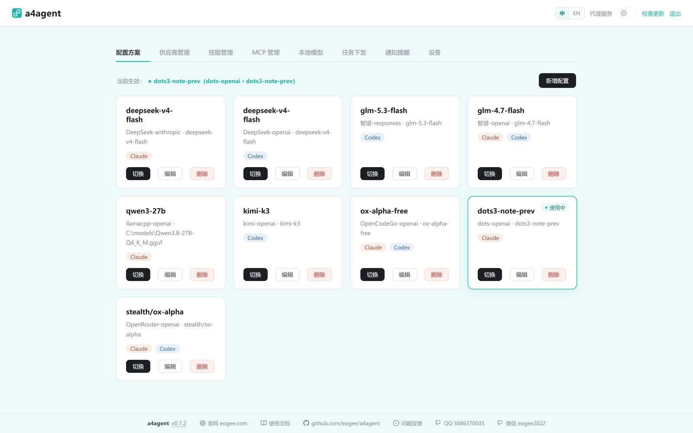
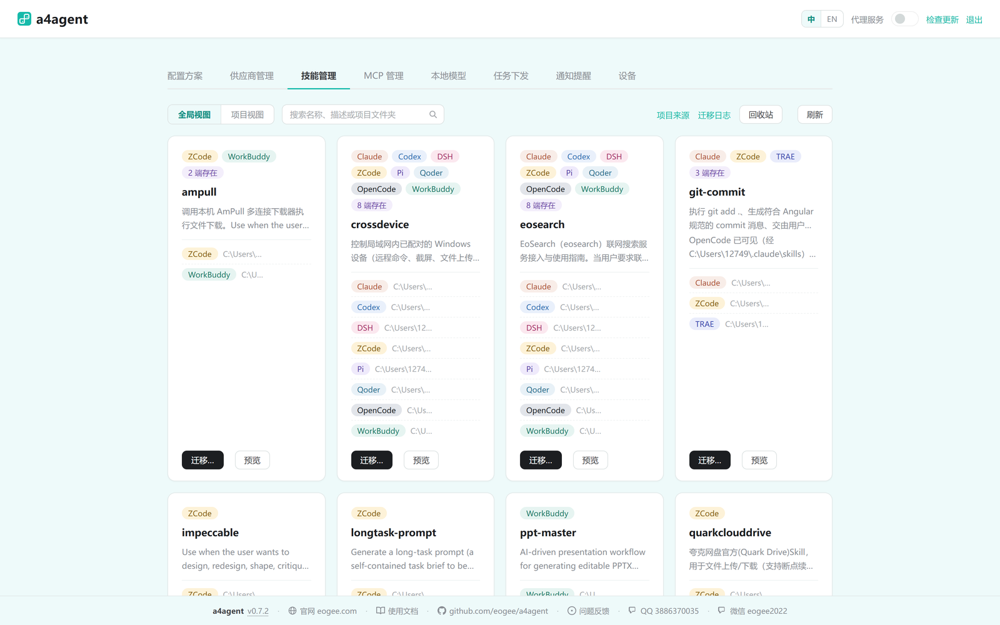
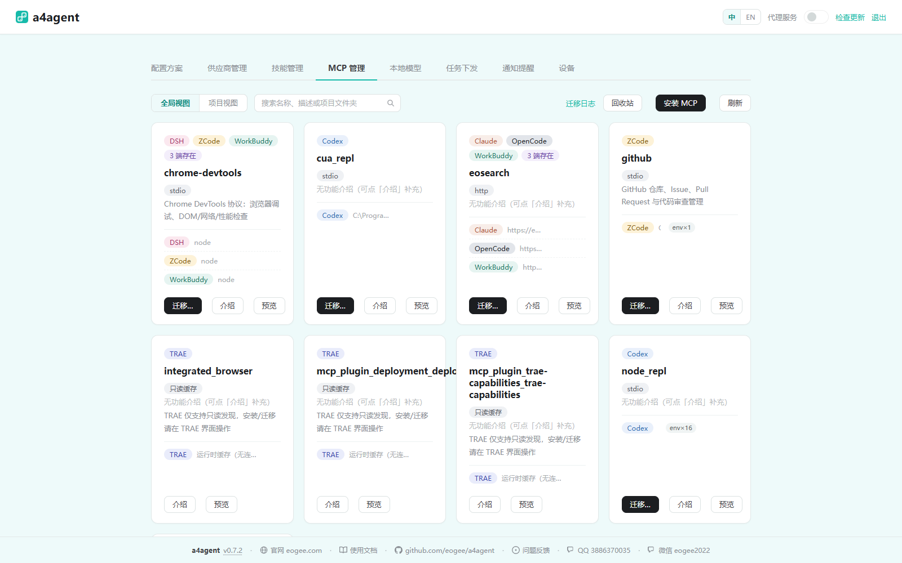
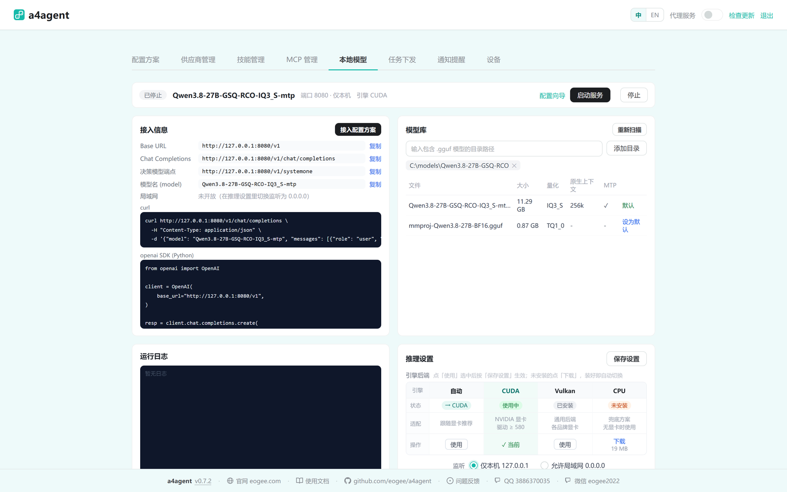
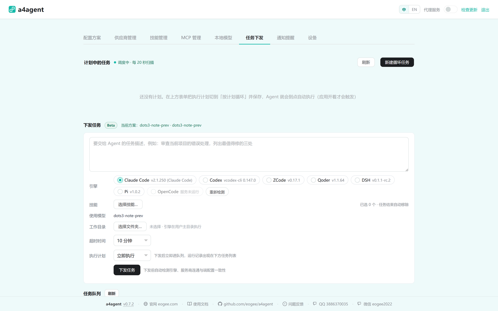
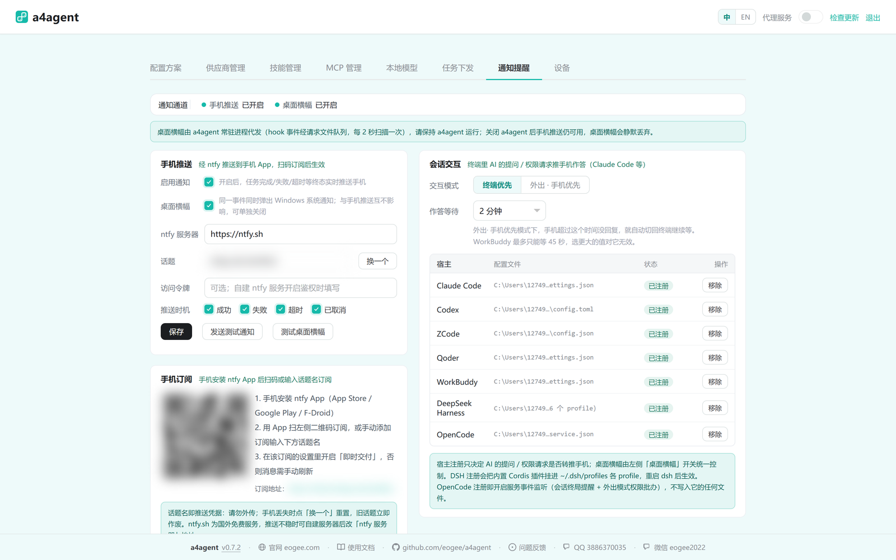
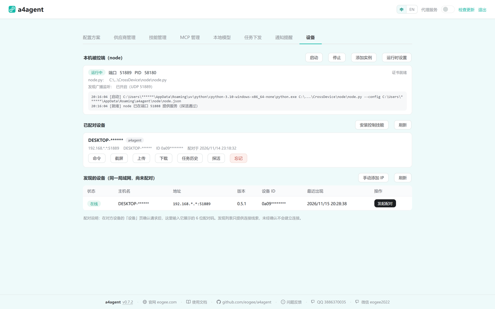

# a4agent

[English](README.md) | 简体中文

[](https://hub.xerj.org/contributors/eogee)

**九端 AI 编程工具管理台 + 本地大模型推理控制台**：为 **Claude Code、Codex、dsh（DeepSeek Harness）、ZCode（智谱 Agentic 开发环境）、pi（本地 pi coding agent）、Qoder（AI IDE）、OpenCode、WorkBuddy 与 TRAE** 提供统一的技能管理与 MCP 管理（九端全覆盖，其中 TRAE 的 MCP 为只读发现），并为其中没有图形配置界面的两个 CLI 工具（Claude Code、Codex）提供 API 服务商切换，内置 llama.cpp 本地模型推理控制台，支持七端无头任务下发（含循环任务与任务级技能注入）、手机推送与桌面横幅、CrossDevice 跨设备控制。所有操作通过可视化界面完成，无需手动编辑配置文件。

| 能力 | 说明 |
|---|---|
| **技能管理** | 九端全局/项目级 skill 自动发现、聚合标注、跨端迁移、回收站恢复，一键把项目 skill 补齐到所有缺失的端 |
| **MCP 管理** | 九端 MCP server 自动发现与**一键安装**、跨端迁移（按传输能力矩阵校验）、快照回收站、自动/自定义**功能介绍**，密钥全程脱敏/加密 |
| **API 切换** | 为无图形界面的 CLI（Claude Code、Codex）一键切换服务商、模型、API Key，配置自动备份、原子写入，密钥 DPAPI 加密存储；其余七端应用自带供应商配置界面，由用户自行配置 |
| **本地模型** | 把任意 `.gguf` 模型一键变成 OpenAI 兼容的本地/局域网 API 服务：引擎按显卡自动获取、模型库扫描、显存风险评估，一键接入配置方案（Claude Code / Codex） |
| **任务下发** | 七端以无头模式后台执行任务：下发即返回、下发前三步预检（引擎可用 / 配置就绪 / 真实连通）、队列轮询、产出留档、取消与超时、关窗不杀任务；支持循环任务（一次性 / 间隔 / 每天 / 每周）与任务级技能注入 |
| **通知提醒** | 手机推送（ntfy）与桌面横幅双通道、三行制统一样式（话题名称 / 通知类型 / 应用名称）；会话 hook 覆盖 Claude Code / Codex / ZCode / Qoder / WorkBuddy / dsh（OpenCode 经服务事件监听同权接入），可在手机上直接作答提问、批办权限 |
| **设备互联** | 以 CrossDevice（MIT）为被控端运行时：局域网发现、一次确认配对、远程命令 / 截屏 / 文件传输 / 任务历史，设备能力可安装为技能交给工作空间内的 AI Agent |
| **界面语言** | 右上角 `中 / EN` 一键切换界面语言，选择本地持久化；首次打开按系统语言自动选择 |

---

## 快速开始

### 下载与安装

从 **发行版（Release）** 页面下载安装包 `a4agent-setup-*.exe`：

- **下载地址**：https://github.com/eogee/a4agent/releases （选择最新版本）
- **系统要求**：Windows 10/11 64 位
- 建议核对下载页提供的 SHA256 校验值，确保文件完整未被篡改

安装包采用**每用户安装（免 UAC）**：双击运行后按向导安装到当前用户目录，全程无需管理员权限，自动创建开始菜单与桌面快捷方式，可在「设置 → 应用」中卸载。首次运行若出现 **Windows SmartScreen 提示**，点击「更多信息 → 仍要运行」即可（应用未做商业代码签名，属正常现象，不影响功能）。

### 启动与界面

安装完成后从**开始菜单**或**桌面快捷方式**启动。主界面共八个页签：**配置方案**（API 切换，仅 Claude Code 与 Codex）、**供应商管理**、**技能管理**、**MCP 管理**、**本地模型**（llama.cpp 推理控制台）、**任务下发**（无头 Agent 任务）、**通知提醒**（手机推送 + 桌面横幅）、**设备**（跨设备控制）。右上角 `中 / EN` 一键切换界面语言。

### 数据与隐私

- 运行时数据（数据库、配置备份）写入 `%APPDATA%\a4agent\`，日志写入 `~/.a4agent/logs/`
- 无头任务的引擎产出写入 `%APPDATA%\a4agent\task_outputs\`（与配置备份同级、仅本机用户可访问）；产出是引擎原始输出，可能包含代码与路径等敏感内容，「问题反馈」**不会**自动附带任务产出，删除任务会同步删除其产出文件
- API Key 使用 Windows DPAPI 加密存储，与当前 Windows 用户绑定
- 修改前自动备份原配置文件（`~/.claude/settings.json` / `~/.codex/config.toml`，滚动保留最近 5 份）

### 常见问题

- **杀毒软件报毒**：PyInstaller 打包的程序偶被安全软件误报，请添加信任或排除，也可将样本提交厂商申诉
- **升级**：直接运行新版 `a4agent-setup-*.exe` 覆盖安装，数据与配置（`%APPDATA%\a4agent\`）保留；升级前自动停止后台翻译代理并清理旧文件
- **从 a4api 升级（v0.3.x → v0.4.0+）**：产品已更名 a4agent，直接安装新版即可——首次启动自动把 `%APPDATA%\a4api\` 数据迁入 `%APPDATA%\a4agent\`，安装器迁移程序目录并清理旧快捷方式，此前写入的 `a4api_p*` 托管条目在下次切换时自动替换为 `a4a_p*`，无需手工处理
- **卸载**：在「设置 → 应用」中卸载；程序文件移除，运行数据保留在 `%APPDATA%\a4agent\`，彻底清除请手动删除该目录
- **任务下发**：关闭主窗口**不等于退出**——应用转入后台把任务跑完，再次启动即唤回原窗口；真正退出请用顶栏「退出」
- **反馈问题**：推荐页脚「问题反馈」直接提交（见文末「问题反馈」）

### 自动更新

发布新版本后，应用在**启动时静默检查**或点顶部「检查更新」时发现更新，确认后下载安装包并显示进度，校验通过再次确认即完成升级；也可「忽略此版本」。

更新源与校验：

- **双源竞速下载**：GitHub 与 Gitee 两镜像**同时下载、快者胜出**（同一 SHA256 绑定两个镜像地址），领先超过 8MB 判胜，进度条始终显示领先者；国内访问 GitHub 资产常只有 ~0.1 MB/s，竞速后自动落到 Gitee 的 ~2 MB/s
- **更新清单签名**：发布侧用 Ed25519 私钥签名 `latest.json`（版本、更新说明、安装包 SHA256 等），应用内置公钥验签；任何字段异常或签名不符，清单直接作废、**不弹更新提示**。URL 不入签名，URL 指向的内容由被签名的 SHA256 绑死
- **完整性校验**：安装包边下边算 SHA256，与签名清单比对通过才落盘（`%APPDATA%\a4agent\updates\<版本>\`）；点「立即更新」时对磁盘文件**再次校验**才拉起安装器
- **传输白名单**：仅 HTTPS，重定向逐跳校验主机白名单（`github.com` / `gitee.com` / 两个 `*.githubusercontent.com` 对象存储域 / `*.gitee.com`）
- **防降级**：候选版本须严格高于当前版本；低于清单 `min_version`（过旧需完整安装包）拒绝；预发布版本仅当当前版本也是预发布时才提示
- **尺寸上限**：清单 512KB、安装包 300MB，超限拒绝；下载只写用户数据目录，不信任系统临时目录

更新流程：检测到新版本弹窗展示版本号与更新说明 → 确认后后台下载（可取消）→ 校验通过点「立即更新」：应用先停本地翻译代理、自动退出释放单实例锁，再拉起 Inno Setup 安装向导，配置、数据库与密钥完整保留。

---

## API 服务商切换（配置方案 · 供应商管理）

a4agent 为**没有图形配置界面的 CLI 工具**提供一键切换：目前是 **Claude Code** 与 **Codex** 两端。「供应商管理」页维护服务商（协议、地址、密钥），「配置方案」页把它们与模型组合成方案，一键切换、顶栏实时显示当前生效方案。

配置方案页：方案卡片一键「切换 / 编辑 / 删除」，当前生效方案在顶栏与卡片上同时可见：



- **Claude Code**：Anthropic 协议直连，或经内置**本地翻译代理**把请求实时翻译为 OpenAI Chat Completions 转发给 OpenAI 兼容服务商（代理仅监听 `127.0.0.1`、随机 token 鉴权，应用退出后仍存活）
- **Codex**：OpenAI Responses 协议写入 `~/.codex/config.toml`；上游原生支持 Responses（如 DeepSeek）时直连，否则经本地代理翻译转发
- 切换前自动备份目标配置文件（滚动保留最近 5 份）并原子写入；API Key 使用 Windows DPAPI 加密存储，接口永不回显明文

### 为什么只代管这两端

判定标准只有一条：**目标应用是否自带完整的供应商配置界面**。

| 端 | 应用内能做什么 | a4agent 的做法 |
|---|---|---|
| Claude Code | 无，纯 CLI | 代管（唯一可行路径） |
| Codex CLI | 无，纯 CLI | 代管（唯一可行路径） |
| dsh | Settings → Models，可选三种 API 协议 + 自动拉取模型清单 | 移交用户自配 |
| ZCode | 设置 → 模型供应商，双接口地址 + 按模型声明能力 | 移交用户自配 |
| pi | `/model` 里直接切换 | 移交用户自配 |
| Qoder | 9 个预置供应商 + 自定义端点 + 连通性校验 | 移交用户自配 |

对自带配置界面的应用，外部代管既不省事（用户点几下更快），又有风险：界面上的能力开关、上下文窗口、启用状态外部写入时无从得知，只能填保守默认值。判定依据是「**用户自己能配**」，不是「我们读不懂它的配置」——Qoder 的模型目录虽经专有加密、外部无法写明文，但用户在界面里配得好好的，技术障碍不构成产品理由。

各端的字段对照与界面入口见 [迁移对照表](docs/迁移对照表-三端API配置.md)。无头任务下发覆盖七端，**直接使用你在各应用内自己配好的配置**——a4agent 不为这些应用写入 API 配置，下发前只做真实性预检（见「任务下发」）。

---

## 技能管理

九个目标端使用同一套技能格式（`<skill-name>/SKILL.md` 目录 + frontmatter 的 `name` 与 `description`），a4agent 把它们当作一种资源统一管理。

技能管理页：九端技能聚合成卡片，端徽章标注存在情况与路径；「项目来源 / 迁移日志 / 回收站」入口在右上角，全局视图与项目视图一键切换：



### 发现与聚合

- 自动扫描九端**全局**与**项目级**技能目录，以 frontmatter `name` 为唯一标识做聚合标注：同名技能跨端存在时自动标记「已在 N 端存在」。
- **项目发现走两条路**：扫描范围默认是本机所有盘符（一级子目录视为项目），同时读取各 AI 工具本来就记着的历史——Claude Code 的项目表、Codex 会话的工作目录、VS Code 系编辑器最近打开的工作区——任意深度的项目都会自己冒出来，不需要你指给它。只收录含至少一个 skill 的项目。
- 「项目来源」弹窗列出自动发现了什么（以及来自哪个工具），可逐条忽略、用目录选择器添加扫描范围，或一键恢复默认范围。
- Codex 全局的保留目录（`.system/` 等点开头目录）自动跳过，不视为用户技能。

### 跨端迁移与「一键适配九端」

- 任意一端的 skill 可迁移到任意目标端（全局或任意项目），迁移为**非破坏复制**：源端永久保留。
- 迁移目标支持**自选项目文件夹**：目标项目无需事先存在任何 skill，`.{tool}/skills` 目录缺失时自动创建；桌面端与浏览器端共用同一套内置目录选择器。
- 目标端已存在同名技能（frontmatter name 或目录名任一命中）时，旧版自动移入回收站而非静默覆盖。
- **「一键适配九端」**：把项目内全部 skill 按其缺失的端一次补齐，先弹计划清单再执行，带进度条并临时锁定页面，防止中途误操作。
- 每次迁移写入**迁移日志**（时间、Skill、源、目标、结果），全程可追溯。

### 回收站

- 删除的 skill 移入回收站，**30 天内**可恢复原位或彻底删除；恢复时原位置被占用会明确报错，绝不覆盖。
- 过期条目在下次访问回收站时惰性清理，并在返回结果中提示本次清理数量。

### 九端技能目录

| 工具 | 全局（用户级） | 项目级 |
|---|---|---|
| Claude Code | `~/.claude/skills/` | `<项目>/.claude/skills/` |
| Codex | `~/.codex/skills/` | `<项目>/.codex/skills/` |
| dsh | `~/.dsh/skills/`（`$DSH_HOME` 可覆盖） | `<项目>/.dsh/skills/` |
| ZCode | `~/.zcode/skills/` | `<项目>/.zcode/skills/` |
| pi | `~/.pi/agent/skills/`（`$PI_CODING_AGENT_DIR` 可覆盖） | `<项目>/.pi/skills/` |
| Qoder | `~/.qoder/skills/`（`$A4AGENT_QODER_HOME` 可覆盖） | `<项目>/.qoder/skills/` |
| OpenCode | `~/.config/opencode/skills/` | `<项目>/.opencode/skills/` |
| WorkBuddy | `~/.workbuddy/skills/`（`$A4AGENT_WORKBUDDY_SKILLS_PATH` 可覆盖） | `<项目>/.workbuddy/skills/` |
| TRAE | `~/.trae-cn/skills/`（`$A4AGENT_TRAE_HOME` / `$A4AGENT_TRAE_SKILLS_PATH` 可覆盖） | `<项目>/.trae/skills/` |

**TRAE**：实际扫描的用户技能目录是产品数据目录下的 `skills`（本机 `~/.trae-cn/skills`），格式与其它端相同，无需特判。`~/.trae-cn/builtin/global/skills` 是 TRAE **内置技能**的物化目录，随 TRAE 更新整体重写，a4agent 不写入、不托管，避免升级时互相覆盖。TRAE 没有 hook 协议、也没有无头 CLI，因此只接技能管理与 MCP 只读发现。

**ZCode**：官方还识别跨工具目录 `~/.agents/skills` 与 `<项目>/.agents/skills`；a4agent 统一托管到 `.zcode` 前缀，与其它端保持一致。迁移到 ZCode 的 skill 会被 ZCode 客户端真实读取。

**pi**：全局技能在 **agent 子目录**下（`~/.pi/agent/skills`，不是 `~/.pi/skills`）。pi 对 skill 的校验比其它端严格：`name` 只能是小写字母、数字与连字符（≤64 字符，不得以连字符首尾或含连续连字符），`description` 必填（≤1024 字符），不合规的 skill **pi 会直接不加载**。迁移到 pi 时 a4agent 按其规则复查一次，不合规在迁移结果里明确警告，而不是留下「迁成功却找不到」的状态。

**Qoder**：除 `~/.qoder/skills` 外还识别跨工具目录 `~/.agents/skills` 与 `<项目>/.agents/skills`（优先级低），a4agent 统一托管到 `.qoder/skills` 前缀，项目级无需特判。配置目录名随发行版而变（国际版 `.qoder`、国内版 `.qoder-cn`），默认探测实际存在的那个，也可用 `A4AGENT_QODER_HOME` 直接指定。

**OpenCode**：全局根在 `~/.config/opencode/skills`（不是 `~/.opencode/skills`），项目级是 `.opencode/skills`。两处按其真实行为特判：**技能 ID 取目录名**，frontmatter `name` 只是显示名，因此聚合与冲突按目录名判定——否则两个「显示名相同、ID 不同」的技能会被错并成一份，或在迁移时被误删；**它会自动发现 `~/.claude/skills` 与 `~/.agents/skills`**（`.agents` 同时是 ZCode / Qoder 的跨工具目录），这类条目标注「OpenCode 已可见」，一键适配时跳过——不必为了 OpenCode 再迁一份。

---

## MCP 管理

九端里除 TRAE（MCP 配置在加密内部库，仅只读发现）外，各端的 MCP server 都写在各自的配置文件里，a4agent 把它们归一为统一视图（`name` / `transport` / `command` / `args` / `env` / `url` / `headers`）。

MCP 管理页：九端 server 同卡片视图聚合，传输类型、功能介绍与所在端一目了然，「安装 MCP」从零新建或粘贴 JSON 批量导入：



### 发现与聚合

- 自动发现九端全局与项目级 MCP server，同名 server 跨端聚合标注（「已在 N 端存在」）。
- **TRAE 只读发现**：TRAE 的用户级 MCP 配置保存在加密内部库（`ModularData/ai-agent/database.db`，非标准 SQLite），明文侧只有运行时缓存 `~/.trae-cn/mcps/<工作区>/<agent>/<server>/`（`SERVER_METADATA.json` + `tools/*.json`）。a4agent 从该缓存读出 **server 名称与工具清单**，卡片明确标注「TRAE 仅支持只读发现」，不伪造连接参数，也不提供安装/删除/迁移入口——请在 TRAE 界面操作。可用 `$A4AGENT_TRAE_MCP_CACHE_PATH` 覆盖缓存位置。
- 详情中 `env` / `headers` **一律脱敏**（只回显键名），API 永不回传明文密钥。
- 每张卡片显示该 server 的**功能介绍**：自动识别常用 server（内置简介库 + npx 包实时查询 npm registry，均有缓存与失败兜底），也支持点「介绍」手工维护说明（本地持久化、跨端共享、留空即清除）。
- 项目级自动识别：Claude Code `.mcp.json`、Codex `.codex/config.toml`、ZCode `.zcode/config.json`、pi `.pi/mcp.json`（Qoder 的项目级就是 Claude Code 的 `.mcp.json`，归 Claude 端托管，不重复发现）。WorkBuddy 只有全局，没有工作区级 MCP 文件。

### 安装 MCP 服务

- 点「安装 MCP」可在任意应用**从零新建** server：选择目标应用（Claude Code / Codex / dsh / ZCode / pi / Qoder / OpenCode / WorkBuddy，写入该应用全局配置）+ 传输类型（stdio / http / sse，按目标端能力自动过滤，如 Codex 仅 stdio、pi 与 OpenCode 无 sse），填写命令/参数/环境变量或地址/请求头。TRAE 只有加密内部库，不出现在安装/迁移目标里。
- 也支持**粘贴 JSON 批量导入**：把已有的 MCP 配置片段直接粘进来（兼容「mcpServers」顶层、名称作键的 server 字典、单对象三种格式），一次装多个，逐条独立——单条失败（同名冲突、目标端不支持该传输等）不中断其余，并逐条报告成功/失败。
- 安装走各端原生渲染与原子写（目标同名已存在会明确拒绝，可改用迁移或先删除），既有 server 与其它配置键原样保留；安装后立即出现在卡片列表，并自动匹配功能介绍。

### 跨端迁移与传输能力矩阵

- 任意端的 server 可迁移到任意目标端；目标端已有同名 server 时**先快照进回收站再写入**，写入前自动备份目标配置文件。
- 迁移按**传输能力矩阵**严格校验，不兼容的组合整对失败并留日志，**不静默降级**：

| 目标端 | 支持的传输 | 配置文件 |
|---|---|---|
| Claude Code | stdio / sse / http | `~/.claude.json`（全局）、`<项目>/.mcp.json`（项目） |
| Codex | stdio | `~/.codex/config.toml`（`[mcp_servers.*]`） |
| dsh | stdio / streamable-http | `~/.dsh/profiles/<profile>/cordis.patch.yml` |
| ZCode | stdio / sse / http | `~/.zcode/cli/config.json`、`<项目>/.zcode/config.json`（`mcp.servers`） |
| pi | stdio / streamable-http | `~/.pi/agent/mcp.json`（全局）、`<项目>/.pi/mcp.json`（项目，需该项目被 pi 信任） |
| Qoder | stdio / sse / http | `~/.qoder/mcp.json`（全局；项目级复用 Claude Code 的 `<项目>/.mcp.json`） |
| OpenCode | stdio / streamable-http | `~/.config/opencode/opencode.json(c)`、`<项目>/.opencode/opencode.json(c)`（`mcp.servers`） |
| WorkBuddy | stdio / sse / http（写回为 `streamableHttp`） | `~/.workbuddy/mcp.json`（仅全局） |
| TRAE | 不支持写入（只读发现） | 加密内部库；明文侧仅 `~/.trae-cn/mcps` 运行时缓存 |

各端差异要点（读写时 a4agent 均无损保留各端自有键）：

- **dsh**：MCP server 挂在 `@deepseek-ai/dsh-mcp-client` 插件条目下，重写时保留其它非管理条目；无项目级 MCP。
- **ZCode**：配置 schema 严格（未知键会被丢弃），a4agent 只写其规范字段（`type`/`command`/`args`/`cwd`/`env`/`url`/`headers`/`enabled`/`timeoutMs`），迁移到 ZCode 的 server 会被客户端自动连接。
- **pi**：与 Claude Code 同构（顶层 `mcpServers`），但**明确拒绝 legacy SSE**（`type: "sse"` 会被判废），sse 条目迁移整对失败并留日志。server 名只接受字母、数字、`_`、`-`，含中文或点号的名字在迁移/安装时明确拒绝（写出即废条目）；项目级文件不接受 `auth` 键，写入时自动剔除并记录日志。
- **Qoder**：与 Claude Code 同构，自有键 `disabled`（在 Qoder 界面里关掉某 server 的开关，注意**不是** `enabled`）、`timeout`、`authType` 无损保留。**项目级 MCP 与 Claude Code 共用同一个 `<项目>/.mcp.json`**（它按 `.mcp.json` → `mcp.json` 顺序查找），a4agent 不让 Qoder 端接管项目级文件——同一文件被两端各写一次只会互相踩，迁到 Claude 项目级即 Qoder 项目级同时生效。运行时镜像（`%APPDATA%\Qoder\SharedClientCache\extension\local\mcp.json`、`~/.qoder/mcp-router.json`）是进程内状态，不读不写、不纳入备份。
- **OpenCode**：配置在 `mcp.servers` 下，只有 `local`（stdio）与 `remote`（Streamable HTTP）两种传输，**没有 legacy SSE 的位置**，sse 来源的条目整对失败并留日志。三处形状差异由 a4agent 抹平：命令是**单个数组**（可执行与参数合一，写回时才拆开）、环境变量键叫 `environment`（不是 `env`）、启停开关叫 `disabled`。`codemode` / `timeout` / `protocol` / `oauth` 等自有键无损保留。
- **WorkBuddy**：与 Claude Code 同构，但 http 传输的字面量是驼峰 **`streamableHttp`**（写成 `http` 它认不出该条目，a4agent 内部归一为 `http`、落盘还原驼峰）；`timeout` 是**每条目**生效的自有键，未识别的键统一进 `extra` 无损往返。只托管全局 `~/.workbuddy/mcp.json`——WorkBuddy 没有工作区级 MCP 配置文件，安装或迁移到项目级会明确报错，而不是写出一份它读不到的文件（技能侧不同：`<工作区>/.workbuddy/skills` 确实存在，项目级技能发现与迁移照常可用）。

**OpenCode 的配置文件是 JSONC**（可带注释与尾逗号）：a4agent 写入的是标准 JSON（合法 JSONC），能正确读取带注释的既有文件，但**该文件上的手写注释会在写入时丢失**——这是「整子树替换」的固有取舍，介意的话改用 OpenCode 自己的界面配置。配置读取失败时 a4agent 会中止写入，绝不按空配置重建（那会清空你的 model / agents / permissions）。

**Qoder 视图「看不到已连接 MCP」是正常的**：a4agent 管理的是**用户自定义**的 `~/.qoder/mcp.json`；Qoder 会话里实际连着的多数连接器并不来自这个文件——内置连接器（浏览器控制、node REPL 等）随安装包分发，插件自带的连接器写在 `~/.qoder/plugins/cache/<来源>/<插件>/mcp.json`，两者都不属于用户配置文件。想让某个 server 出现在 Qoder 端视图，用「安装 MCP」或跨端迁移把它写进这个文件即可。

### 回收站与数据保护

- 被替换/删除的 server 配置片段**快照进回收站**（30 天内可恢复）；快照中的 `env` / `headers` 用 **DPAPI 加密**落盘，恢复时解密写回。
- 每次迁移写入日志；发现、预览、回收站接口对敏感字段全程脱敏。

---

## 本地模型（llama.cpp 推理控制台）

本地模型页：接入信息、模型库与推理设置三个卡片，服务状态与引擎日志实时可见，健康检查就绪后自动通知：



「本地模型」页签把 llama.cpp 的 `llama-server` 封装为一键启动的 **OpenAI 兼容 API 服务**：装哪个引擎、选哪个模型、给什么参数，全程可视化操作。

**引擎版本**：llama.cpp **b11719**（2026-10-18 nightly，钉死在 `backend/app/llama/catalog.py`，单一事实来源）。该版本的 `llama-server` 包含决策模型端点，因此下方能力可用。

### 决策模型（System One）

除常规的 `/v1/chat/completions` 与 `/v1/models` 外，该版本引擎还提供 **`/v1/systemone` 决策模型端点**——接入卡片直接给出完整地址与 curl / OpenAI SDK 调用示例，可把「该用哪个模型、怎么拆解任务」这类调度决策交给本地引擎，主模型留在云上，形成云边协同。

### 首次配置向导

按「获取引擎 → 检测硬件 → 选择模型目录 → 选择默认模型 → 服务端口」五步完成全部配置：

- **硬件检测与预设推荐**：通过 `nvidia-smi` 与注册表枚举显卡（厂商、显存、驱动版本）；依据显存档位推荐推理预设（上下文长度、KV 缓存量化、MTP 投机解码），选择模型时给出显存溢出风险提示
- **引擎自动获取**：按显卡自动下载 llama.cpp **官方预编译引擎**（钉定版本、可复现），四套可选：

  | 引擎包 | 适用显卡 | 体积 | 最低驱动 |
  |---|---|---|---|
  | CUDA 13.4 | NVIDIA（性能优先） | 552 MB | 580 |
  | CUDA 12.4 | NVIDIA（兼容旧驱动） | 628 MB | 550 |
  | Vulkan | NVIDIA / AMD / Intel 独显与核显 | 31 MB | 无 |
  | CPU | 无可用显卡时的兜底 | 18 MB | 无 |

  也支持**离线安装**（指定含 `llama-server.exe` 的目录）或暂时跳过；CUDA 引擎 = 主包 + cudart 运行库包，下载后自动解压合并
- **一个后端一套引擎，设置页可切换**：引擎装进 `%LOCALAPPDATA%\Programs\a4agent-<后端>\engine`，重下某个后端不会覆盖另一个后端正在用的引擎；实际在跑的后端按目录里的 DLL 识别（`ggml-cuda` > `ggml-vulkan` > `ggml-cpu`）并显示在顶栏，「本地模型」设置页的**引擎后端**对比表（自动 / CUDA / Vulkan / CPU 并排显示状态、适配与操作）已装的点「使用」，未装的直接给下载入口，切换下次启动服务生效
- 已装有旧版 a4agent 时自动**接管其引擎目录**，无需重复下载

### 模型库与服务运行

- 添加多个模型目录，自动扫描 `.gguf` 并解析元数据：**大小、量化级别、原生上下文、是否含 MTP 层**（支持投机解码）；一键「设为默认模型」
- 「启动服务」实时显示运行状态（启动中 / 运行中 / 失败 / 已停止）与引擎日志；健康检查就绪后通知；端口占用、引擎缺失、进程崩溃均有明确日志提示；支持定时内存裁剪
- 推理参数可视化调整：上下文长度、KV 缓存级别（f16/q8_0/q4_0）、Flash Attention、GPU 层数、API Key 鉴权、附加参数逃生舱
- **MTP 投机解码步数**自动适配：llama.cpp 的 MTP 写法随版本变化（旧版 `--mtp N`，b105xx 起改为 `--spec-type draft-mtp --spec-draft-n-max N`），a4agent 跑一次 `llama-server --help` 自动探测当前后端支持哪种写法再下发参数，跨版本升级不会因此启动失败

### 局域网开放与一键接入

- 「接入」卡片给出 Base URL、Chat Completions 地址、决策端点（System One）、模型名（`model` 字段）与可直接复制的 **curl / OpenAI SDK** 示例；推理设置切换为 `0.0.0.0` 监听后显示实际局域网调用地址
- **「接入配置方案」**一键创建指向本地服务的配置方案，弹窗勾选要写入的应用（Claude Code / Codex），到「配置方案」页切换即可让对应应用用上本地模型，与云上 API 无缝互切

---

## 任务下发（无头 Agent 任务）

任务下发页：下发表单（任务描述 / 引擎 / 技能 / 超时）与任务队列同屏，引擎未安装自动置灰并给出原因，循环任务在页内一并管理：



「任务下发」页签把各端的**无头（headless）模式**产品化：写一句任务描述、选一个引擎，a4agent 就在后台把 CLI 拉起来跑完、把产出留档，你可以继续干别的事。

### 支持的引擎

| 引擎 | 无头命令 | 产出形态 |
|---|---|---|
| **Claude Code** | `claude -p "<任务>" --output-format json` | JSON 单对象，产出在 `result`，含 token 用量与成本 |
| **Codex** | `codex exec --json --ephemeral` | JSONL 事件流，取 `agent_message` 类型的产出 |
| **ZCode** | `zcode -p "<任务>" --json` | JSON 单对象，产出在 `text`，含 `toolCalls` / `usage` / `stopReason` |
| **Qoder** | `qodercli -p "<任务>" -o json` | JSON 单对象 |
| **dsh** | `dsh --profile headless "<任务>"` | stdout 直出（能解析为 JSON 时抽正文字段） |
| **pi** | `pi -p "<任务>" --mode json --no-session` | JSONL 事件流，按 `stopReason` 定成败、按事件取文本 |
| **OpenCode** | **不走 CLI**，对运行中的服务建会话 | 会话消息流，取 assistant 文本；成本/用量/成败取自会话终态 |

- 引擎自动探测（安装状态 / 版本 / 可执行路径），**未安装的在界面置灰**并给出原因
- 所有命令先把命令名解析成绝对路径：Windows 上这些 CLI 都是 npm 的 `.cmd` 壳，直接把命令名交给 `subprocess` 会启动失败。Qoder 的命令名官方文档写 `qodercli`、博客写 `qoder`，两个名字都探测
- 无头模式下没有人能点审批，因此每条命令都带权限预授权参数，否则会卡在审批或被直接拒绝：Claude Code 用 `--permission-mode bypassPermissions`、Codex 用 `--sandbox danger-full-access`、ZCode 用 `--mode yolo`、Qoder 与 pi 用 `--yolo`（dsh 不需要，其 headless profile 本身即无头入口）。dsh 还会生成 `--patch` 覆盖层屏蔽 profile 里的外部插件（headless profile 缺少它们依赖的 host 服务，不屏蔽会在启动阶段直接失败），不改 profile 本身

### OpenCode：与其它端的差异

其它六端都是「每次新起一个 CLI 进程」，OpenCode 则是**对接你已经开着的那台服务**（本机默认 `127.0.0.1:49374`，服务密码与端口自动发现，也可填远程地址），换来三样命令行走不到的能力：

- **免审批不污染全局配置**：预授权是**会话级权限规则**（实测会话对象原样回显），任务结束即失效。其它端只能用 `--yolo` / `bypassPermissions` 这类全局开关
- **成败不靠猜**：会话终态直接给 `outcome`（成功 / 失败 / 被中断）、成本与用量；失败原因取自结构化的 `error` 字段，不用从退出码反推
- **可中断**：取消是对服务端会话发 interrupt，不是杀进程

OpenCode 也不受「必须先有一个生效的配置方案」的限制——它的模型与凭据在 OpenCode 里，不走 a4agent 的方案体系。另外实测有一类隐蔽故障：服务端模型清单里标记为可用的模型可能已被上游废弃，真跑才报错，所以预检第三步与正式执行都会在遇到「模型被拒」时换一个可用模型重试。

### 下发前自动预检（不通就不入队）

点「下发任务」会先同步做三步检查，任一步失败就**不启动引擎**，并用人话告诉你为什么：

| 步骤 | 检查什么 |
|---|---|
| 引擎可用 | 目标 CLI 已安装且真能执行（结果缓存 5 分钟） |
| 配置就绪 | 读**你自己在应用内配好的配置**，判断是否已配好服务商与模型。读不到时（如 Qoder 的模型目录经专有加密）如实说明「无法校验，请以实测结果为准」，不假装通过 |
| 真实连通 | 用最小提示词真实跑一次无头调用，拿到产出才算通过 |

真实调用不管你怎么配都能给出诚实答案：密钥有效没、模型名拼写对不对、网络通不通，一次调用全都会暴露出来。配置还没配好时不会跑实测（跑必然失败，白白等待）。被拦下的任务仍会留一条 `precheck_failed` 记录，队列里可以看到失败在哪一步、耗时多少。

### 循环任务（执行计划）

「任务下发」页同时承载**循环任务**：把一个无头任务定义成可重复的执行计划，由调度器按时拉起。

- **四种触发计划**（全部按本地时间）：`once` 一次性（YYYY-MM-DD HH:MM）、`interval` 每 N 分钟（上限一周，再长该用 daily/weekly）、`daily` 每天固定时刻、`weekly` 每周选定星期 + 时刻
- **调度随应用存活**：调度器是应用进程内的守护线程（20 秒扫描精度），应用退出即停；停机期间错过的触发默认只记一条 missed，勾选 catch_up 才补跑一次
- **每轮执行落一条任务记录**，复用一次性任务的整条链路：超时、日志、取消、终态通知全部同路径；循环任务超时上限 4 小时（手动任务 1 小时）
- 页面能力：新建 / 编辑、启停、立即执行、运行历史与日志、删除

### 任务级技能注入

七端 CLI 都没有「指定使用哪个 skill」的命令行参数，技能只靠目录发现（`~/.<tool>/skills` 与 `<工作目录>/.<tool>/skills`）。下发表单的**「技能」选择器**把选中的技能注入本次任务工作目录的发现路径，让 Agent 真实用到它，任务结束自动回收：

- **只加不减**：全局/项目里已有的其它技能照常加载，注入只增不删
- **冲突让路**：目标位置已有同名目录时只跳过，绝不覆盖、绝不进回收站
- **只动自己建的**：回收只清理本次注入的条目，应用启动时还会清扫崩溃残留
- **端兼容预警**：所选端不会加载的技能（如不合 pi 命名规则的技能）在选择时即警示「该端不会加载此技能」
- 循环任务同样可配技能，每轮触发时自动带入本轮执行

### 队列与产出

- **下发即返回**：接口只建任务行并交给后台线程池（默认并发 5，`A4AGENT_TASK_CONCURRENCY` 可调），不等结果
- 状态机：`排队中 → 执行中 → 已完成 / 失败 / 超时 / 已取消 / 预检未通过`，界面 2 秒轮询，全部空闲自动停表
- 「查看产出」弹窗显示引擎产出全文（长产出只回传末尾部分，文件里始终完整）与预检各步耗时
- 支持**取消**（杀整棵进程树，node 壳会派生子进程）、任务历史、删除（同步清理产出文件）
- 超时默认 10 分钟（可选 5–60 分钟），到点强杀并标记超时
- 产出落盘 `%APPDATA%\a4agent\task_outputs\<任务号>.jsonl|md`，与其它运行数据同目录

### 关窗不杀任务

- **关闭主窗口 = 转入后台常驻**，任务与循环任务继续执行；再次启动 a4agent 会自动唤回原实例的窗口而不是新起一个进程
- 常驻**托盘图标**：左键唤回窗口，右键菜单可直接退出。退出时先收托盘，再回收本地推理引擎与无头任务子进程，后台不留残留
- 二次启动抢不到单例锁时不再只弹一句「已在运行」：先尝试唤回被隐藏的窗口，唤不到则清障重启，兜底实例仍失败才告诉你去任务管理器结束进程
- 真正的退出入口是顶栏「**退出**」，会先告知还有几个任务在跑并二次确认；退出时如实把运行中任务标记为「应用退出」并终止其进程树
- 任务到终态时：窗口开着就在页面内提示；窗口已隐藏则弹**原生系统通知**（带提示音，来源区显示 a4agent logo 与应用名，点击唤回窗口）并闪烁任务栏图标

---

## 通知提醒（手机推送与桌面横幅）

通知提醒页：手机推送配置（话题 / 二维码 / 订阅地址）与会话交互宿主表格同页，桌面横幅开关在下方（截图已对推送凭据字段打码）：



两条独立通道让你不必守在电脑前，且**全端一个样式**——话题名称 / 通知类型 / 应用名称三行制，纯文字无 Emoji：

- **手机推送**（ntfy）：任务与会话终局（成功 / 失败 / 超时）送达，始终带 **Agent 最后一段输出**
- **桌面横幅**（来源区 logo + a4agent）：覆盖完成 / 失败 / 权限申请 / 提问，点击唤回窗口
- **会话交互**：会话 hook 覆盖 **Claude Code / Codex / ZCode / Qoder / WorkBuddy / dsh**，Agent 的提问与权限请求推到手机上直接作答、批办（批准 / 总是允许 / 拒绝）；「外出·手机优先」模式下手机超时未回复，自动切回终端继续
- **OpenCode 同权接入**：它没有 hook 协议，「注册」开启的是 a4agent 侧的服务事件监听——你在 OpenCode 网页端发起的会话，跑完 / 出错 / 被中断都走同一条桌面横幅 + 手机推送（横幅无论窗口是否开着都会弹），权限请求同样推手机批办后经其 permission API 回给服务、会话继续；注册**不写它的任何文件**

---

## 设备互联（CrossDevice 跨设备控制）

设备页：已配对设备与局域网发现的设备分栏管理，远程命令、截屏、文件与任务历史入口随卡片展开，node 运行时状态常显：



- 「设备」页把 [CrossDevice](https://github.com/eogee/CrossDevice)（MIT）作为被控端运行时管理：a4agent 以独立子进程拉起并守护本机 node（退出自动重启、连续快速崩溃 5 次熔断、证书缺失自动生成），并支持**具名多实例**——设置清单里的每个实例独立拉起、独立守护
- 双端安装 a4agent 后，同一局域网内的设备经 UDP 广播自动出现在「发现的设备」列表（约 10 秒心跳，30 秒无帧判离线）；广播只提供「看得见」，**不自动建立信任**
- **一次确认配对**：控制端点「发起配对」→ 被控端 a4agent 弹确认窗（显示来源 IP）→ 确认后同屏展示一次性 6 位配对码（5 分钟时效）→ 控制端输码 → 连接建立，此后远程命令、截屏、上传下载、任务历史免手工可用。**配对请求到达时被控端弹系统横幅提醒**，设备页没开着也不会错过确认时机
- 被控端点「拒绝」则连接不建立；配对码猜错达上限（默认 5 次）会话即作废；配对成功/失败/拒绝全程落被控端审计
- 已配对设备的凭据（令牌与证书指纹）经 Windows DPAPI 加密存储在本机，接口与文件层均不回传明文；证书指纹变更会被拒绝，可在设备页重置指纹后重新连接
- node 运行时文件（node.py / gen_cert.ps1 / python-embed 解释器）随 a4agent 安装包分发到安装目录 `node_runtime/`，全新机零依赖；也可在设备页手动指定路径（开发态可直接用 CrossDevice 仓）

### 上传白名单与暂存目录

- 对已配对设备的**写方向操作**（上传 / 写 / 删 / 建目录 / 移动）受**被控端工作空间白名单**约束（读取不限）：白名单默认空 = 仅 **node 默认暂存目录**可写（被控端 node 数据目录下 `tmp`，如 `%APPDATA%\a4agent\node\tmp`），其余写方向一律拒绝（403 `SANDBOX_DENIED`）；显式配置的根与暂存目录并存生效（用户根最多 16 个，暂存目录不计入）
- 暂存目录定位「自动化友好」：node 启动自动创建、恒可用——上传的脚本 / 临时产物先 put 到这里再经 exec 执行
- 白名单是**被控端本地配置**：设备页与接口都**不提供远程修改**——需要扩大范围时由设备所有者编辑被控端 `node.json` 的 `"workspace"` 键（如 `"workspace": ["D:\\Shared"]`）并重启 node，或以 `--workspace` 启动参数指定
- 允许根可查询：被拒报错（`SANDBOX_DENIED`）的 message 会列出当前允许根（另有机读字段 `allowed_roots`）；设备页 / `GET /api/v1/devices/{name}/workspaces` 可随时查询允许根与暂存目录的确切路径（node v0.5.1+，只读）

### exec 命令引号语义（node v0.5.1+）

- **cmd 形态**（默认）：命令行**逐字直达**被控端 `cmd /c`——内嵌引号原样生效，参数含空格直接写引号即可：`tasklist /FI "IMAGENAME eq x.exe"`、`python -c "print(1)"`
- **powershell 形态**：经 `-EncodedCommand`（UTF-16LE base64）执行，语义同 `-Command` 但无引号歧义，深层嵌套引号同样可靠
- **none 形态**：按 Windows argv 语义切分命令行（引号内空格不拆散）
- 任务历史与接口响应中的 `cmd` 始终是调用方**原文**

### Agent 开放交互（把设备能力交给 AI Agent）

- 设备页「已配对设备」区的 **「安装控制技能」** 把 CrossDevice 控制技能安装到 Agent 技能目录，三档范围：**全局技能库**（九端通用）、**项目目录**（已注册项目根）、**自定义目录**；目标已有同名技能时不覆盖、如实报告
- 安装后，工作空间内的 AI Agent（Claude Code / Codex / ZCode 等）经 SKILL.md 发现设备能力：每次会话先调 `GET /api/v1/devices/overview` 动态获取已配对设备全景，再按设备名调用远程命令、截屏、上传下载、任务历史接口（backend 只监听 127.0.0.1，地址记录在 `%APPDATA%\a4agent\desktop.json`）
- 边界如实声明：Agent **只能操作已配对设备**（配对确认是设备所有者在设备页的人工动作，Agent 无权发起新配对）；设备凭据由 a4agent 加密托管、不出现在任何接口响应中；Agent 的远程操作同样落被控端审计

---

## 开发与打包

### 开发环境

Windows 10+，Python 3.10，[uv](https://docs.astral.sh/uv/)：

```bash
uv sync                                     # 安装依赖
uv run python desktop.py                    # 启动桌面应用
uv run python dev_server.py                 # 浏览器调试（http://127.0.0.1:18900）
uv run uvicorn backend.app.main:app --port 8000   # 后端单独调试
```

### 打包

编译安装包需 [Inno Setup 6](https://jrsoftware.org/isinfo.php)（`winget install --id JRSoftware.InnoSetup -e --accept-source-agreements`）：

```bash
uv run python build.py                 # 生成 dist/a4agent/（文件夹版 onedir）
uv run python build.py --installer     # 文件夹版 + 编译安装包 dist/a4agent-setup-<版本>.exe
uv run python build.py --onefile       # 可选：生成单 exe（临时分发用）
```

版本号自动取自 `pyproject.toml`（`[project].version`），也可用 `--version` 覆盖；ISCC.exe 自动探测（`--iscc` 指定路径）。

### 测试

```bash
uv run pytest backend/app/tests -q
```

42 个测试模块、约 780 个用例，覆盖 hooks、MCP 各端适配、引擎命令、更新器、设备互联等核心面。

### 项目结构

```
a4agent/
├── desktop.py                # pywebview 桌面入口（关窗后台常驻、二次启动唤回原窗口）
├── build.py                  # 打包脚本（PyInstaller onedir + Inno Setup 安装包）
├── installer.iss             # Inno Setup 安装脚本（每用户安装、免 UAC，内嵌 node_runtime）
├── dev_server.py             # 开发态后端启动脚本（浏览器访问调试）
├── dev_server.bat            # Windows 双击启动 dev_server.py 的批处理
├── pyproject.toml            # 依赖清单与版本号单一来源
├── backend/app/              # FastAPI 后端
│   ├── main.py               # 应用入口、生命周期与路由挂载
│   ├── api/v1/               # REST 路由层：configs / providers / switch / skills / mcp /
│   │                         #   llama / tasks / loops / phone / devices / update /
│   │                         #   feedback / removal / desktop / fs
│   ├── models.py             # SQLAlchemy 数据模型
│   ├── schemas.py            # Pydantic 请求/响应模式
│   ├── crud.py               # 数据库增删改查
│   ├── database.py           # 数据库初始化与目录布局
│   ├── config_manager.py     # 配置方案与服务商管理
│   ├── config_io.py          # 公共配置 IO（逐端备份、原子写入）
│   ├── openai_proxy.py       # Anthropic → OpenAI 本地翻译代理
│   ├── responses_translator.py  # OpenAI Responses 协议翻译
│   ├── proxy_standalone.py   # 独立进程形态的翻译代理
│   ├── crypto.py             # Windows DPAPI 密钥加密
│   ├── skill_manager.py      # 九端技能发现、聚合、迁移与回收站
│   ├── mcp_manager.py        # 九端 MCP 发现（TRAE 只读）、安装、迁移与快照
│   ├── task_engines.py       # 无头任务引擎适配（七端命令与产出解析）
│   ├── task_precheck.py      # 下发前三步预检（引擎 / 配置 / 真实连通）
│   ├── task_runner.py        # 任务执行器（线程池、进程树、超时）
│   ├── task_skills.py        # 任务级技能注入与回收（只动自建条目）
│   ├── task_notify.py        # 任务终态事件广播（桌面横幅 / 手机推送的共同源头）
│   ├── loop_schedule.py      # 循环任务触发计划（解析 / 下次触发时间 / 计划描述）
│   ├── loop_scheduler.py     # 循环任务调度器（20 秒扫描、missed / catch_up）
│   ├── opencode_client.py    # OpenCode 服务会话客户端（HTTP 引擎）
│   ├── opencode_listen.py    # OpenCode 服务事件监听（SSE：终局提醒 / 权限批办）
│   ├── workbuddy_listen.py   # WorkBuddy 提问面板监听（会话 jsonl → 桌面横幅）
│   ├── mail.py               # 用户反馈邮件发送
│   ├── removal.py            # 托管配置清理（只删自写条目）
│   ├── removal_backup.py     # 清理前的永久快照
│   ├── phone/                # 通知提醒：config（话题 / 令牌 / 事件开关）/ ntfy（推送客户端）/
│   │                         #   notifier（三行制统一样式拼装 + Agent 最后输出）
│   ├── hooks/                # 会话 hook：dispatch（事件路由）/ handlers（提问 / 审批 / 完成）/
│   │                         #   register（挂载到各工具）/ deskqueue（桌面弹窗延迟代发）/
│   │                         #   transcript（最后输出与话题抽取）/ dsh / dsh_register（Cordis 插件挂载）
│   ├── devices/              # CrossDevice：pool（UDP 发现池）/ pair_watcher（配对系统 toast）/
│   │                         #   node_proc（node 守护与具名多实例）/ store（凭据 DPAPI 存储）
│   ├── win_toast.py          # 桌面通知横幅门面（原生 WinRT toast 优先，legacy 气泡降级）
│   ├── win_toast_native.py   # WinRT 原生 toast（ctypes 直调 COM，零第三方依赖）
│   ├── updater.py            # 应用自更新（清单验签、双源竞速下载）
│   ├── llama/                # 本地模型推理控制台：catalog（引擎目录）/ gguf（模型解析）/
│   │                         #   gpu（硬件检测）/ downloader（引擎下载）/ runtime 与 server
│   │                         #   （服务运行）/ presets（推理预设）/ config / lan（局域网）
│   └── tests/                # pytest 测试套件（42 个模块）
├── frontend/
│   ├── index.html            # 八页签主界面
│   ├── js/app.js             # 配置方案 / 供应商 / 技能管理 / MCP 管理页逻辑
│   ├── js/llama.js           # 本地模型页逻辑
│   ├── js/tasks.js           # 任务下发页逻辑
│   ├── js/loops.js           # 循环任务（执行计划）渲染
│   ├── js/phone.js           # 通知提醒页逻辑（手机推送 / 桌面横幅 / hook 挂载）
│   ├── js/devices.js         # 设备页逻辑（发现 / 配对 / 远程操作）
│   ├── js/skillpick.js       # 公共技能选择弹层（任务下发与循环任务共用）
│   ├── js/dirpicker.js       # 内置目录选择器
│   ├── js/i18n.js            # 中英文案字典与 DOM 应用器
│   ├── js/markdown.js        # 更新说明 Markdown 渲染
│   ├── css/ · layui/         # 样式与 LayUI 组件库
│   └── changelog.md          # 应用内更新弹窗展示的更新说明
├── docs/                     # 迁移对照表（README 引用的唯一跟踪文档；其余设计/实施记录仅本地）
├── resources/                # logo 与安装包图标 / dsh-hook（挂到 ~/.dsh 的 Cordis 插件源码）
├── assets/screenshots/       # README 功能截图（中英双语两套）
└── tools/                    # 端到端烟测脚本（e2e_task_smoke.py）与 UI 探针（probe_selects.py）
```

运行时数据（数据库、配置备份、llama 配置与引擎）写入 `backend/database/`（开发）或 `%APPDATA%\a4agent\`（打包后）。

---

## 问题反馈

推荐应用内入口——页脚「问题反馈」直接提交，支持截图（≤10 张 × ≤1MB）、自动附带环境信息与可选日志，直达开发者邮箱 eogee@qq.com。

GitHub Issue 已配置结构化模板（**Bug 报告 / 功能需求**），按表单填写即可；手动提交前请确认以下信息，缺失可能导致问题无法定位：

1. **明确类型**：Bug 报告 / 功能建议 / 使用疑问，选择对应标签，便于分流处理
2. **环境信息（必填）**：a4agent 版本号（发行版页面标注的版本）；目标应用（Claude Code / Codex / dsh / ZCode 等）；服务商与模型（如 DeepSeek、智谱 GLM）
3. **复现步骤**：从打开应用到出现问题的完整操作路径，尽量写明「做了什么 → 实际结果 → 预期结果」
4. **日志**：附上 `~/.a4agent/logs/a4agent.log` 的**相关片段**（不要整份粘贴，截取报错前后内容）
5. **报错信息与截图**：界面报错文案、终端输出、异常截图一并附上
6. **隐私红线**：**切勿在 Issue 中粘贴 API Key、模型密钥等敏感信息**；日志可能含敏感内容时先脱敏
7. **排查先行**：提交前先自查——重启应用、确认 API Key 有效、确认本机能访问上游服务、确认无代理/杀软干扰

提交前请先搜索是否已有相同 Issue，避免重复提交。

---

## 联系方式

- **官网**：<https://eogee.com>
- **使用文档**：<https://eogee.com/article/83>
- **QQ**：3886370035 ｜ **微信**：eogee2022
- **问题反馈**：推荐应用内页脚「问题反馈」直接提交（支持截图），直达开发者邮箱 eogee@qq.com；也可按「问题反馈」章节要求提 Issue
